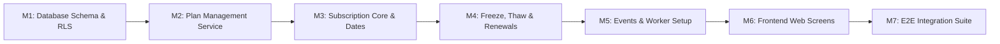

# GYMOS — STAGE 2.5 IMPLEMENTATION PLAN
## Membership & Subscription Management (Automation-First Multi-Tenant SaaS)

**Document Version:** 1.0.0  
**Target Module:** Membership Plans, Member Subscriptions, Lifecycle & Expiry, Renewals, Freezes & Cancellations  
**Status:** DRAFT / PENDING APPROVAL  
**Prerequisites:** Stage 2.1 (RLS), Stage 2.2 (Auth & RBAC), Stage 2.3 (Multi-Branch), Stage 2.4 (Member Management)  
**Latest Baseline Commit:** `5b1a9be` (133/133 E2E Tests Passing)  

---

## 1. Product Vision & Architecture Goals

GymOS is designed from the ground up as an **automation-first multi-tenant SaaS platform** for fitness clubs and gym chains. 

In traditional gym software, membership management is a manual ledger. In GymOS, a **Membership Subscription** is a stateful lifecycle engine that powers:
1. **Automated Access Control:** Real-time gate/turnstile sync based on membership validity (`ACTIVE` vs `EXPIRED`/`FROZEN`).
2. **Predictive Retention Automation:** Event triggers at $T-7$, $T-3$, and $T-1$ days before expiry for automated WhatsApp and SMS renewal alerts.
3. **Flexible Gym Business Models:** Single-branch access, multi-branch cross-fitness privileges, custom corporate discounts, and flexible freeze/hold policies.
4. **Uncompromising Multi-Tenant Security:** PostgreSQL Row-Level Security (RLS) enabled and forced on every table, with strict tenant isolation and branch-aware RBAC.

> [!IMPORTANT]
> **Scope Boundaries for Stage 2.5:**
> - **In Scope:** Membership plans, member subscriptions, custom pricing/discounts, date computations, renewals, freezes/thaws, cancellations, branch scoping, RLS, RBAC, audit logging, automation event contracts, and frontend dashboard screens.
> - **Out of Scope (Reserved for Future Stages):** Payment gateway integration (Razorpay/Stripe in Stage 2.6), Point-of-Sale (POS) invoicing, biometric turnstile hardware integration (Stage 2.7), WhatsApp API delivery (Worker automation pipeline).

---

## 2. Database Schema Design (Prisma & PostgreSQL)

### 2.1 Enums

```prisma
enum PlanDurationType {
  DAYS
  MONTHS
  YEARS
}

enum PlanScope {
  SINGLE_BRANCH
  MULTI_BRANCH
  ALL_BRANCHES
}

enum PlanStatus {
  ACTIVE
  INACTIVE
  ARCHIVED
}

enum MembershipStatus {
  PENDING       // Scheduled for a future start date
  ACTIVE        // Currently active and valid
  FROZEN        // Temporarily paused, access suspended, end date shifts
  EXPIRED       // Past end date without renewal
  CANCELLED     // Terminated early upon customer or staff request
  TERMINATED    // Revoked due to policy violation or administrative action
}

enum FreezeStatus {
  ACTIVE        // Freeze currently in effect
  COMPLETED     // Thawed naturally or manually, days credited to end date
  CANCELLED     // Freeze cancelled before starting
}
```

---

### 2.2 Models

#### 1. `MembershipPlan` (`membership_plans`)
Defines the templates of memberships offered by the organization (e.g., "Annual All-Access", "Monthly Basic", "10-Day Pass").

```prisma
model MembershipPlan {
  id                    String            @id @default(uuid()) @map("id") @db.Uuid
  organizationId        String            @map("organization_id") @db.Uuid
  name                  String            @map("name") @db.VarChar(150)
  code                  String            @map("code") @db.VarChar(50)
  description           String?           @map("description") @db.VarChar(1000)
  
  // Duration & Pricing
  durationType          PlanDurationType  @default(MONTHS) @map("duration_type")
  durationValue         Int               @map("duration_value") // e.g., 1 (month), 3 (months), 365 (days)
  price                 Decimal           @map("price") @db.Decimal(10, 2)
  registrationFee       Decimal           @default(0.00) @map("registration_fee") @db.Decimal(10, 2)
  currency              String            @default("INR") @map("currency") @db.VarChar(10)
  
  // Scope & Policies
  scope                 PlanScope         @default(SINGLE_BRANCH) @map("scope")
  maxFreezeDays         Int               @default(0) @map("max_freeze_days") // Maximum total freeze days permitted
  maxFreezes            Int               @default(0) @map("max_freezes")     // Maximum number of freeze requests allowed
  gracePeriodDays       Int               @default(0) @map("grace_period_days") // Days after expiry before access cut
  
  // Features / Perks (Stored as structured JSON)
  features              Json?             @default("[]") @map("features")
  
  status                PlanStatus        @default(ACTIVE) @map("status")
  createdAt             DateTime          @default(now()) @map("created_at") @db.Timestamptz
  updatedAt             DateTime          @updatedAt @map("updated_at") @db.Timestamptz
  
  // Relations
  organization          Organization      @relation(fields: [organizationId], references: [id], onDelete: Cascade)
  branchScopes          MembershipPlanBranch[]
  subscriptions         MemberMembership[]

  @@unique([organizationId, code], map: "unique_org_plan_code")
  @@index([organizationId], map: "idx_membership_plans_org")
  @@index([organizationId, status], map: "idx_membership_plans_org_status")
  @@map("membership_plans")
}
```

#### 2. `MembershipPlanBranch` (`membership_plan_branches`)
Maps plans to specific branches when `scope == MULTI_BRANCH` or `SINGLE_BRANCH`.

```prisma
model MembershipPlanBranch {
  id                String          @id @default(uuid()) @map("id") @db.Uuid
  organizationId    String          @map("organization_id") @db.Uuid
  planId            String          @map("plan_id") @db.Uuid
  branchId          String          @map("branch_id") @db.Uuid
  createdAt         DateTime        @default(now()) @map("created_at") @db.Timestamptz

  organization      Organization    @relation(fields: [organizationId], references: [id], onDelete: Cascade)
  plan              MembershipPlan  @relation(fields: [planId], references: [id], onDelete: Cascade)
  branch            Branch          @relation(fields: [branchId], references: [id], onDelete: Cascade)

  @@unique([planId, branchId], map: "unique_plan_branch")
  @@index([organizationId, branchId], map: "idx_plan_branches_org_branch")
  @@map("membership_plan_branches")
}
```

#### 3. `MemberMembership` (`member_memberships`)
The central subscription record linking a gym customer (`Member`) to a `MembershipPlan`.

```prisma
model MemberMembership {
  id                    String            @id @default(uuid()) @map("id") @db.Uuid
  organizationId        String            @map("organization_id") @db.Uuid
  memberId              String            @map("member_id") @db.Uuid
  planId                String            @map("plan_id") @db.Uuid
  homeBranchId          String            @map("home_branch_id") @db.Uuid
  
  // Schedule & Dates
  startDate             DateTime          @map("start_date") @db.Date
  endDate               DateTime          @map("end_date") @db.Date // Computed from duration + extensions
  originalEndDate       DateTime          @map("original_end_date") @db.Date // Preserved anchor before freezes
  
  // Pricing & Overrides
  basePrice             Decimal           @map("base_price") @db.Decimal(10, 2)
  discountAmount        Decimal           @default(0.00) @map("discount_amount") @db.Decimal(10, 2)
  discountReason        String?           @map("discount_reason") @db.VarChar(255)
  finalPrice            Decimal           @map("final_price") @db.Decimal(10, 2)
  registrationFee       Decimal           @default(0.00) @map("registration_fee") @db.Decimal(10, 2)
  currency              String            @default("INR") @map("currency") @db.VarChar(10)
  
  // Freeze Tracking
  totalFreezeDaysUsed   Int               @default(0) @map("total_freeze_days_used")
  freezeCount           Int               @default(0) @map("freeze_count")
  
  // Renewal & Succession
  renewalCount          Int               @default(0) @map("renewal_count")
  previousMembershipId  String?           @map("previous_membership_id") @db.Uuid
  
  status                MembershipStatus  @default(ACTIVE) @map("status")
  autoRenew             Boolean           @default(false) @map("auto_renew")
  notes                 String?           @map("notes") @db.Text
  
  // Cancellation metadata
  cancelledAt           DateTime?         @map("cancelled_at") @db.Timestamptz
  cancellationReason    String?           @map("cancellation_reason") @db.VarChar(255)
  cancelledBy           String?           @map("cancelled_by") @db.Uuid
  
  createdAt             DateTime          @default(now()) @map("created_at") @db.Timestamptz
  updatedAt             DateTime          @updatedAt @map("updated_at") @db.Timestamptz

  // Relations
  organization          Organization      @relation(fields: [organizationId], references: [id], onDelete: Cascade)
  member                Member            @relation(fields: [memberId], references: [id], onDelete: Cascade)
  plan                  MembershipPlan    @relation(fields: [planId], references: [id], onDelete: Restrict)
  homeBranch            Branch            @relation(fields: [homeBranchId], references: [id], onDelete: Restrict)
  freezes               MembershipFreeze[]
  history               MembershipHistory[]

  @@index([organizationId], map: "idx_member_memberships_org")
  @@index([organizationId, memberId], map: "idx_member_memberships_member")
  @@index([organizationId, status], map: "idx_member_memberships_status")
  @@index([organizationId, endDate], map: "idx_member_memberships_end_date")
  @@index([organizationId, homeBranchId], map: "idx_member_memberships_branch")
  @@map("member_memberships")
}
```

#### 4. `MembershipFreeze` (`membership_freezes`)
Tracks temporary pauses/holds on subscriptions and automatically shifts expiry dates upon thaw.

```prisma
model MembershipFreeze {
  id                    String            @id @default(uuid()) @map("id") @db.Uuid
  organizationId        String            @map("organization_id") @db.Uuid
  membershipId          String            @map("membership_id") @db.Uuid
  
  startDate             DateTime          @map("start_date") @db.Date
  endDate               DateTime?         @map("end_date") @db.Date // Projected unfreeze date
  actualThawDate        DateTime?         @map("actual_thaw_date") @db.Date // Actual date thawed
  daysFrozen            Int               @default(0) @map("days_frozen")
  
  reason                String?           @map("reason") @db.VarChar(255)
  status                FreezeStatus      @default(ACTIVE) @map("status")
  
  frozenBy              String            @map("frozen_by") @db.Uuid // Staff User ID
  thawedBy              String?           @map("thawed_by") @db.Uuid
  
  createdAt             DateTime          @default(now()) @map("created_at") @db.Timestamptz
  updatedAt             DateTime          @updatedAt @map("updated_at") @db.Timestamptz

  organization          Organization      @relation(fields: [organizationId], references: [id], onDelete: Cascade)
  membership            MemberMembership  @relation(fields: [membershipId], references: [id], onDelete: Cascade)

  @@index([organizationId], map: "idx_membership_freezes_org")
  @@index([membershipId], map: "idx_membership_freezes_membership")
  @@map("membership_freezes")
}
```

#### 5. `MembershipHistory` (`membership_history`)
Immutable append-only audit trail of membership lifecycle events (assignments, renewals, freezes, thaws, edits, cancellations).

```prisma
model MembershipHistory {
  id                    String            @id @default(uuid()) @map("id") @db.Uuid
  organizationId        String            @map("organization_id") @db.Uuid
  membershipId          String            @map("membership_id") @db.Uuid
  action                String            @map("action") @db.VarChar(50) // e.g. "ASSIGNED", "RENEWED", "FROZEN", "THAWED", "CANCELLED"
  actorId               String?           @map("actor_id") @db.Uuid
  previousState         Json?             @map("previous_state")
  newState              Json?             @map("new_state")
  reason                String?           @map("reason") @db.VarChar(255)
  timestamp             DateTime          @default(now()) @map("timestamp") @db.Timestamptz

  organization          Organization      @relation(fields: [organizationId], references: [id], onDelete: Cascade)
  membership            MemberMembership  @relation(fields: [membershipId], references: [id], onDelete: Cascade)

  @@index([organizationId, membershipId], map: "idx_membership_history_membership")
  @@map("membership_history")
}
```

---

### 2.3 Row-Level Security (RLS) Policies
Each of the 5 new tables will be secured with standard GymOS tenant isolation policies:

```sql
-- Example for member_memberships
ALTER TABLE "member_memberships" ENABLE ROW LEVEL SECURITY;
ALTER TABLE "member_memberships" FORCE ROW LEVEL SECURITY;

CREATE POLICY "tenant_isolation_policy_member_memberships" ON "member_memberships"
  FOR ALL
  USING (
    NULLIF(current_setting('app.is_super_admin', true), '') = 'true'
    OR organization_id = NULLIF(current_setting('app.current_tenant_id', true), '')::uuid
  )
  WITH CHECK (
    NULLIF(current_setting('app.is_super_admin', true), '') = 'true'
    OR organization_id = NULLIF(current_setting('app.current_tenant_id', true), '')::uuid
  );
```

---

## 3. Business Logic & Date Computation Engine

### 3.1 Expiry Date Computation
When a membership is assigned or renewed, the end date is computed deterministically:
- **`DAYS`:** `endDate = startDate + durationValue days - 1 day`
- **`MONTHS`:** `endDate = addMonths(startDate, durationValue) - 1 day`
- **`YEARS`:** `endDate = addYears(startDate, durationValue) - 1 day`

*Example:* A 1-Month membership starting on `2026-03-01` expires on `2026-03-31 23:59:59` (next renewal due `2026-04-01`).

### 3.2 Freeze & Thaw Date-Shift Algorithm
1. When frozen on `freezeStartDate`:
   - Subscription status changes to `FROZEN`.
   - `MembershipFreeze` created with `status: ACTIVE`.
   - Member access is revoked at gate/turnstile.
2. When thawed on `thawDate`:
   - Number of elapsed days calculated: `daysFrozen = differenceInCalendarDays(thawDate, freezeStartDate)`.
   - `totalFreezeDaysUsed = totalFreezeDaysUsed + daysFrozen`.
   - Subscription `endDate` is extended: `endDate = endDate + daysFrozen`.
   - Subscription status restored to `ACTIVE`.
   - `MembershipFreeze` updated with `actualThawDate` and `status: COMPLETED`.

### 3.3 Seamless Renewal Logic
- **Early Renewal (Active):** If member renews while current membership is still `ACTIVE`, the new subscription's `startDate = currentMembership.endDate + 1 day`. No overlap, zero lost days.
- **Lapsed Renewal (Expired):** If member renews after previous membership `EXPIRED`, the new subscription's `startDate = today` (or chosen future date).
- **History Linkage:** `previousMembershipId` links to the predecessor, forming an audit chain.

---

## 4. RBAC Permissions Matrix

The following permissions will be added to `@gymos/shared-types`:

| Permission | GYM_OWNER | BRANCH_MANAGER | RECEPTIONIST | TRAINER | MEMBER |
|:---|:---:|:---:|:---:|:---:|:---:|
| `MEMBERSHIP_PLAN_READ` | ✅ | ✅ | ✅ | ✅ | ❌ |
| `MEMBERSHIP_PLAN_MANAGE` | ✅ | ✅ | ❌ | ❌ | ❌ |
| `MEMBER_SUBSCRIPTION_READ` | ✅ | ✅ | ✅ | ✅ | ✅ (Own) |
| `MEMBER_SUBSCRIPTION_ASSIGN` | ✅ | ✅ | ✅ | ❌ | ❌ |
| `MEMBER_SUBSCRIPTION_RENEW` | ✅ | ✅ | ✅ | ❌ | ❌ |
| `MEMBER_SUBSCRIPTION_FREEZE` | ✅ | ✅ | ✅ | ❌ | ❌ |
| `MEMBER_SUBSCRIPTION_CANCEL` | ✅ | ✅ | ❌ | ❌ | ❌ |

---

## 5. REST API Endpoint Specifications

Base Path: `/api/v1/memberships`

### 5.1 Membership Plan APIs
| Method | Endpoint | Permission | Description |
|:---|:---|:---|:---|
| `POST` | `/api/v1/memberships/plans` | `MEMBERSHIP_PLAN_MANAGE` | Create new membership plan |
| `GET` | `/api/v1/memberships/plans` | `MEMBERSHIP_PLAN_READ` | List plans (filterable by branch, status, scope) |
| `GET` | `/api/v1/memberships/plans/:id` | `MEMBERSHIP_PLAN_READ` | Get plan details and branch availability |
| `PATCH`| `/api/v1/memberships/plans/:id` | `MEMBERSHIP_PLAN_MANAGE` | Update plan details, price, features |
| `PATCH`| `/api/v1/memberships/plans/:id/status` | `MEMBERSHIP_PLAN_MANAGE` | Toggle plan status (`ACTIVE`/`INACTIVE`) |

### 5.2 Member Subscription APIs
| Method | Endpoint | Permission | Description |
|:---|:---|:---|:---|
| `POST` | `/api/v1/memberships/subscriptions` | `MEMBER_SUBSCRIPTION_ASSIGN` | Assign a plan to a member (with discount/date overrides) |
| `GET` | `/api/v1/memberships/subscriptions` | `MEMBER_SUBSCRIPTION_READ` | Query subscriptions (filter by member, branch, status, expiry) |
| `GET` | `/api/v1/memberships/subscriptions/:id`| `MEMBER_SUBSCRIPTION_READ` | Get subscription details with freeze and renewal history |
| `GET` | `/api/v1/members/:memberId/memberships`| `MEMBER_SUBSCRIPTION_READ` | Get all memberships (active + history) for a specific member |
| `POST` | `/api/v1/memberships/subscriptions/:id/renew` | `MEMBER_SUBSCRIPTION_RENEW` | Renew subscription (same or upgraded plan) |
| `POST` | `/api/v1/memberships/subscriptions/:id/freeze` | `MEMBER_SUBSCRIPTION_FREEZE` | Freeze an active membership |
| `POST` | `/api/v1/memberships/subscriptions/:id/thaw` | `MEMBER_SUBSCRIPTION_FREEZE` | Thaw / unfreeze a frozen membership |
| `POST` | `/api/v1/memberships/subscriptions/:id/cancel` | `MEMBER_SUBSCRIPTION_CANCEL` | Cancel membership with reason |

---

## 6. Automation-First Event Contracts

All membership lifecycle actions will emit structured events to Redis/BullMQ. These events form the core automation hooks for Stage 2.6+ (messaging & notifications):

```typescript
export interface MembershipCreatedEvent {
  event: 'membership.created';
  organizationId: string;
  memberId: string;
  membershipId: string;
  planName: string;
  startDate: string;
  endDate: string;
  finalPrice: number;
}

export interface MembershipExpiringSoonEvent {
  event: 'membership.expiring_soon';
  organizationId: string;
  memberId: string;
  membershipId: string;
  daysRemaining: 7 | 3 | 1;
  endDate: string;
  memberPhone: string;
  memberName: string;
}

export interface MembershipExpiredEvent {
  event: 'membership.expired';
  organizationId: string;
  memberId: string;
  membershipId: string;
  expiryDate: string;
  autoRevokeAccess: boolean;
}

export interface MembershipFrozenEvent {
  event: 'membership.frozen';
  organizationId: string;
  memberId: string;
  membershipId: string;
  freezeStartDate: string;
  reason?: string;
}

export interface MembershipThawedEvent {
  event: 'membership.thawed';
  organizationId: string;
  memberId: string;
  membershipId: string;
  daysFrozen: number;
  newEndDate: string;
}
```

---

## 7. Frontend Screens & UI/UX Plan

### Screen 1: Membership Plans Directory & Builder
- **Route:** `/dashboard/memberships/plans`
- **Features:**
  - Card / Table view of plans with status chips (`ACTIVE`, `INACTIVE`).
  - "Create Plan" slide-over modal: duration picker, pricing, registration fee, multi-branch selector, freeze policy rules, features list tag-input.
  - Quick toggle to activate/deactivate plans.

### Screen 2: Member Subscriptions List & Expiry Dashboard
- **Route:** `/dashboard/memberships`
- **Features:**
  - Summary metrics: Active Subscriptions, Expiring in 7 Days, Frozen, Expired.
  - Table view filterable by Status, Branch, and Date range.
  - Search by Member Name, Phone, or Member #.

### Screen 3: Member Profile Membership Tab
- **Route:** `/dashboard/members/[memberId]` (Integrated Tab)
- **Features:**
  - **Active Membership Hero Card:** Current plan name, days remaining progress bar, start/end dates, freeze quota status.
  - **Action Buttons:** "Renew Membership", "Freeze", "Cancel".
  - **Membership History Timeline:** Chronological accordion showing previous plans, renewals, and freeze records.

### Screen 4: Subscription Modals
- **Assign Plan Modal:** Plan selector, start date, custom discount inputs, auto-computed end date and total price.
- **Renewal Modal:** Pre-fills successor dates; supports plan upgrade.
- **Freeze Modal:** Date range picker, remaining freeze quota calculator, preview of new shifted end date.

---

## 8. Implementation Milestones



- **Milestone 1:** Prisma schema migrations (`20261121000000_membership_management`), RLS policies with `ENABLE + FORCE`.
- **Milestone 2:** `@gymos/shared-types` and `@gymos/validation` updates. Membership plans CRUD module.
- **Milestone 3:** Subscription assignment service with date calculation engine and branch scoping.
- **Milestone 4:** Freeze/thaw logic with automatic expiry shifting, renewal chaining, cancellation handler.
- **Milestone 5:** Audit logging and BullMQ automation event dispatchers.
- **Milestone 6:** Next.js dashboard screens (`/dashboard/memberships`, `/dashboard/memberships/plans`, member profile integration).
- **Milestone 7:** E2E test suite (`test/membership-management.e2e-spec.ts`) targeting 25+ integration & security scenarios.

---

## 9. Review Checklist Before Implementation Approval

- [ ] Database schema addresses single-branch and multi-branch gym access.
- [ ] Concurrency and RLS constraints confirmed for all 5 new tables.
- [ ] Date computation rules handling leap years and month boundaries verified.
- [ ] RBAC permissions aligned with gym operational roles.
- [ ] Lifecycle event contracts compatible with background workers.
- [ ] No regression on existing 133 tests.
