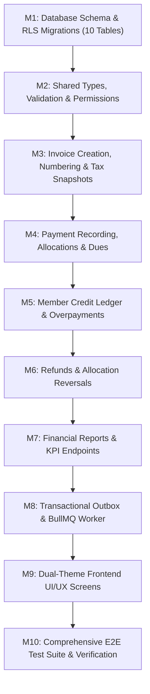

# GYMOS — STAGE 2.6 FINAL IMPLEMENTATION PLAN
## Billing, Invoices, Payments & Financial Records

**Document Version:** 2.0.0  
**Status:** REVISED & APPROVED ARCHITECTURE  
**Target Module:** Tax Invoicing (GST/SAC), Manual Payment Collection (Cash, UPI, Card, Bank Transfer, Cheque), Allocation-Based Settlement Ledger, Allocation Reversals, Member Credit Ledger, Dues Tracking, Financial Reporting, Dual-Theme UI/UX  
**Prerequisites:** Stages 2.1–2.5 (Tenant Isolation, Auth & RBAC, Multi-Branch, Member Foundation, Membership & Subscription Engine)  
**Baseline Commit:** `e917370` (153/153 E2E Tests Passing)  

---

# 1. Product Objective

Build a production-ready, automation-first financial management module for GymOS that enables gym owners and authorized branch staff to:

- Generate professional, tax-compliant invoices with immutable purchase-time snapshots.
- Record payments received through **Cash**, **UPI**, **Card**, **Bank Transfer**, **Cheque**, and **Member Credit**.
- Support partial payments and full payments seamlessly.
- Allocate payments across one or multiple invoices.
- Track outstanding dues with aging analysis (0–30, 31–60, 60+ days) and manage overpayments.
- Process partial and full refunds with complete audit history and explicit allocation reversals.
- Maintain an auditable member credit ledger for advance deposits, overpayments, and credit redemptions.
- Generate operational and financial reports (daily collections, MTD revenue, branch performance, payment method breakdowns).
- Emit automation-ready financial lifecycle events via a transactional outbox for future automated reminders and receipts.

The module must be automation-ready without implementing the complete Automation Engine or third-party WhatsApp APIs in this stage.

---

# 2. Critical Financial Domain Separation

Two completely independent financial domains must exist within the platform:

```
+-----------------------------------------------------------------------------------+
|                           GYMOS PLATFORM ARCHITECTURE                             |
+-----------------------------------------------------------------------------------+
                                        |
     +----------------------------------+----------------------------------+
     |                                                                     |
     v                                                                     v
+----------------------------------------+  +---------------------------------------+
|  A. GymOS Platform Billing (B2B)       |  |  B. Gym Business Billing (B2C)        |
|  - Gym Organization -> GymOS Platform  |  |  - Gym Member -> Gym Business         |
|  - SaaS Plan: Starter, Pro, Enterprise |  |  - Memberships, Training, Add-ons     |
|  - Platform Invoicing & Platform Acct  |  |  - Cash, UPI, Card, NetBanking, Cheque|
|  - Platform Subscription Schema        |  |  - Tenant-Scoped RLS (No SuperBypass) |
+----------------------------------------+  +---------------------------------------+
```

## A. GymOS Platform Billing (B2B)
Gym organizations pay GymOS for software subscriptions and platform services.
- Platform-owned merchant accounts (e.g. platform Stripe/Razorpay accounts).
- Platform subscription records and tier licenses.
- Platform invoices and receipts billed to the gym organization.
- Platform financial reports.

## B. Gym Business Billing (B2C)
Gym members pay their respective gym businesses for memberships, training, and merchandise.
- Gym-owned merchant accounts, bank accounts, POS terminals, and physical cash drawers.
- Organization-scoped tax invoices and payments.
- Branch-level collection records.
- Member dues, credits, and gym financial reports.

> [!CAUTION]
> **STRICT ARCHITECTURAL RULE:**
> Never mix platform subscription payments with gym member payments, merchant accounts, invoice sequences, APIs, financial reports, or database ownership.
> Stage 2.6 implements **Gym Business Billing (B2C) manual payment recording and reconciliation only**. Third-party payment gateway integration is explicitly out of scope.

---

# 3. Financial Architecture

## 3.1 Accounting Terminology & Classification

Payment allocation is **NOT** double-entry accounting.

Stage 2.6 implements:
- Immutable financial transaction records.
- Line-item payment allocation records.
- Explicit refund and allocation reversal records.
- An append-only member credit ledger.
- Auditable, verifiable financial balances.

Do not advertise or document this as a complete double-entry accounting ledger. A genuine accounting ledger with a chart of accounts, balanced debit/credit journal entries, and general ledger posting can be introduced in a dedicated future accounting milestone.

## 3.2 Core Financial Invariants

1. **Issued Invoices Are Immutable:** Issued invoices must never be silently edited, overwritten, or deleted. Any modification requires cancellation via an audited `VOID` status.
2. **Completed Payments Are Immutable:** Completed payments must never be silently overwritten or deleted. Corrections require explicit reversal/refund operations.
3. **Refunds Are Explicit Financial Transactions:** Every refund is an audited event linked to the original payment and recorded with a reason, initiator, and approver.
4. **Allocation Reversals Preserve History:** Original `PaymentAllocation` records are preserved intact. Reversals are tracked in dedicated `PaymentAllocationReversal` records, recalculating invoice balances without data destruction.
5. **Auditable Member Credit:** Member credit is tracked in an append-only transaction ledger with running balances derivable from ledger entries.
6. **Decimal/Numeric Precision:** All monetary amounts must use PostgreSQL `Decimal(10, 2)` (or `Decimal(12, 2)`) to eliminate floating-point rounding errors.
7. **Transactional Consistency:** Every financial mutation must be tenant-scoped, execute within a PostgreSQL ACID transaction (`withTenantContext`), and use row-level locking where required.
8. **Idempotency:** Every mutation endpoint requires an `idempotencyKey` to guarantee that network retries never duplicate financial records or allocations.
9. **Complete Audit Trail:** Every completed transaction captures actor IDs (`createdById`, `collectedById`, `initiatedById`, `approvedById`) and timestamps.
10. **Immutable Tax & Business Snapshots:** Historical invoices store JSON snapshots (`supplierSnapshot`, `customerSnapshot`, `taxSnapshot`) ensuring subsequent gym profile, address, or tax rule changes never mutate past invoices.

---

# 4. Database Architecture

Every tenant-owned table implements **PostgreSQL Row-Level Security (RLS) with `ENABLE` and `FORCE`**.

## 4.1 Ten Core Database Entities

```
+----------------------------------------------------------------------------------------------------+
|                                    STAGE 2.6 ENTITY RELATIONSHIPS                                  |
+----------------------------------------------------------------------------------------------------+

       +--------------------+                +---------------------+
       |      Invoice       |<-------------->|     InvoiceItem     |
       +--------------------+                +---------------------+
         |                ^                             |
         | 1:N            |                             | (links to MemberMembership)
         v                |                             v
       +--------------------+                +---------------------+
       | PaymentAllocation  |<---------------|       Payment       |
       +--------------------+                +---------------------+
         ^                ^                             |
         | 1:N            | 1:N                         | 1:N
         |                |                             v
       +--------------------+                +---------------------+
       |AllocationReversal  |<---------------+       Refund        |
       +--------------------+                +---------------------+

       +--------------------+                +---------------------+
       | MemberCreditAccount|<-------------->|  MemberCreditEntry  |
       +--------------------+                +---------------------+
         |
         +---------------------------------> (Redeemed as payment / created from overpayment)

       +--------------------+                +---------------------+
       |OrgBillingSequence  |                | BillingOutboxEvent  |
       +--------------------+                +---------------------+
```

### 1. `Invoice` (`invoices`)
The central tax invoice issued by the gym to a member.

```prisma
model Invoice {
  id                    String            @id @default(uuid()) @map("id") @db.Uuid
  organizationId        String            @map("organization_id") @db.Uuid
  branchId              String            @map("branch_id") @db.Uuid
  memberId              String            @map("member_id") @db.Uuid
  
  // Sequential FY Numbering: e.g. INV/2026-27/00001
  invoiceNumber         String            @map("invoice_number") @db.VarChar(50)
  financialYear         String            @map("financial_year") @db.VarChar(10) // e.g. "2026-27"
  sequenceNumber        Int               @map("sequence_number")
  
  issueDate             DateTime          @map("issue_date") @db.Date
  dueDate               DateTime          @map("due_date") @db.Date
  currency              String            @default("INR") @map("currency") @db.VarChar(10)
  
  // Financial Amounts (Decimal for exact precision)
  subtotal              Decimal           @map("subtotal") @db.Decimal(10, 2)
  discountAmount        Decimal           @default(0.00) @map("discount_amount") @db.Decimal(10, 2)
  discountReason        String?           @map("discount_reason") @db.VarChar(255)
  taxableAmount         Decimal           @map("taxable_amount") @db.Decimal(10, 2)
  
  // India GST Breakdown
  cgstAmount            Decimal           @default(0.00) @map("cgst_amount") @db.Decimal(10, 2)
  sgstAmount            Decimal           @default(0.00) @map("sgst_amount") @db.Decimal(10, 2)
  igstAmount            Decimal           @default(0.00) @map("igst_amount") @db.Decimal(10, 2)
  cessAmount            Decimal           @default(0.00) @map("cess_amount") @db.Decimal(10, 2)
  totalTaxAmount        Decimal           @default(0.00) @map("total_tax_amount") @db.Decimal(10, 2)
  
  totalAmount           Decimal           @map("total_amount") @db.Decimal(10, 2)
  allocatedAmount       Decimal           @default(0.00) @map("allocated_amount") @db.Decimal(10, 2)
  balanceDue            Decimal           @map("balance_due") @db.Decimal(10, 2)
  
  status                InvoiceStatus     @default(ISSUED) @map("status")
  
  // Immutable Purchase-Time Snapshots
  supplierSnapshot      Json              @map("supplier_snapshot")
  customerSnapshot      Json              @map("customer_snapshot")
  taxSnapshot           Json              @map("tax_snapshot")
  placeOfSupply         String            @map("place_of_supply") @db.VarChar(2) // State Code (e.g. "27")
  
  notes                 String?           @map("notes") @db.Text
  terms                 String?           @map("terms") @db.Text
  createdById           String            @map("created_by_id") @db.Uuid
  
  // Audited Void Fields (Voided numbers remain archived and never reused)
  voidedAt              DateTime?         @map("voided_at") @db.Timestamptz
  voidReason            String?           @map("void_reason") @db.VarChar(255)
  voidedById            String?           @map("voided_by_id") @db.Uuid
  
  createdAt             DateTime          @default(now()) @map("created_at") @db.Timestamptz
  updatedAt             DateTime          @updatedAt @map("updated_at") @db.Timestamptz

  // Referential Integrity: RESTRICT Cascade Deletions
  organization          Organization      @relation(fields: [organizationId], references: [id], onDelete: Restrict)
  branch                Branch            @relation(fields: [branchId], references: [id], onDelete: Restrict)
  member                Member            @relation(fields: [memberId], references: [id], onDelete: Restrict)
  items                 InvoiceItem[]
  allocations           PaymentAllocation[]

  @@unique([organizationId, invoiceNumber], map: "unique_org_invoice_number")
  @@index([organizationId], map: "idx_invoices_org")
  @@index([organizationId, branchId], map: "idx_invoices_branch")
  @@index([organizationId, memberId], map: "idx_invoices_member")
  @@index([organizationId, status], map: "idx_invoices_status")
  @@index([organizationId, dueDate], map: "idx_invoices_due_date")
  @@map("invoices")
}
```

### 2. `InvoiceItem` (`invoice_items`)
Line items recording itemized services with SAC/HSN codes and item tax calculations.

```prisma
model InvoiceItem {
  id                    String            @id @default(uuid()) @map("id") @db.Uuid
  organizationId        String            @map("organization_id") @db.Uuid
  invoiceId             String            @map("invoice_id") @db.Uuid
  
  itemType              InvoiceItemType   @default(MEMBERSHIP) @map("item_type")
  description           String            @map("description") @db.VarChar(255)
  sacHsnCode            String?           @default("999723") @map("sac_hsn_code") @db.VarChar(20) // SAC 999723 for Gym services
  quantity              Int               @default(1) @map("quantity")
  unitPrice             Decimal           @map("unit_price") @db.Decimal(10, 2)
  discountAmount        Decimal           @default(0.00) @map("discount_amount") @db.Decimal(10, 2)
  taxableAmount         Decimal           @map("taxable_amount") @db.Decimal(10, 2)
  
  // Item Tax Rates & Amounts
  taxRate               Decimal           @default(0.00) @map("tax_rate") @db.Decimal(5, 2)
  cgstRate              Decimal           @default(0.00) @map("cgst_rate") @db.Decimal(5, 2)
  sgstRate              Decimal           @default(0.00) @map("sgst_rate") @db.Decimal(5, 2)
  igstRate              Decimal           @default(0.00) @map("igst_rate") @db.Decimal(5, 2)
  taxAmount             Decimal           @default(0.00) @map("tax_amount") @db.Decimal(10, 2)
  totalAmount           Decimal           @map("total_amount") @db.Decimal(10, 2)
  
  membershipId          String?           @map("membership_id") @db.Uuid
  createdAt             DateTime          @default(now()) @map("created_at") @db.Timestamptz

  organization          Organization      @relation(fields: [organizationId], references: [id], onDelete: Restrict)
  invoice               Invoice           @relation(fields: [invoiceId], references: [id], onDelete: Restrict)
  membership            MemberMembership? @relation(fields: [membershipId], references: [id], onDelete: SetNull)

  @@index([organizationId, invoiceId], map: "idx_invoice_items_invoice")
  @@map("invoice_items")
}
```

### 3. `Payment` (`payments`)
Immutable record of money received from a gym member.

```prisma
model Payment {
  id                    String            @id @default(uuid()) @map("id") @db.Uuid
  organizationId        String            @map("organization_id") @db.Uuid
  branchId              String            @map("branch_id") @db.Uuid
  memberId              String            @map("member_id") @db.Uuid
  
  paymentNumber         String            @map("payment_number") @db.VarChar(50) // e.g. REC/2026-27/00001
  financialYear         String            @map("financial_year") @db.VarChar(10)
  sequenceNumber        Int               @map("sequence_number")
  
  amount                Decimal           @map("amount") @db.Decimal(10, 2)
  currency              String            @default("INR") @map("currency") @db.VarChar(10)
  method                PaymentMethod     @map("method")
  status                PaymentStatus     @default(COMPLETED) @map("status")
  
  transactionReference  String?           @map("transaction_reference") @db.VarChar(100) // 12-digit UPI UTR, Card Auth Code
  bankName              String?           @map("bank_name") @db.VarChar(100)
  chequeNumber          String?           @map("cheque_number") @db.VarChar(50)
  chequeDate            DateTime?         @map("cheque_date") @db.Date
  
  paidAt                DateTime          @default(now()) @map("paid_at") @db.Timestamptz
  collectedById         String            @map("collected_by_id") @db.Uuid
  idempotencyKey        String?           @unique @map("idempotency_key") @db.VarChar(200)
  notes                 String?           @map("notes") @db.Text
  
  createdAt             DateTime          @default(now()) @map("created_at") @db.Timestamptz
  updatedAt             DateTime          @updatedAt @map("updated_at") @db.Timestamptz

  organization          Organization      @relation(fields: [organizationId], references: [id], onDelete: Restrict)
  branch                Branch            @relation(fields: [branchId], references: [id], onDelete: Restrict)
  member                Member            @relation(fields: [memberId], references: [id], onDelete: Restrict)
  allocations           PaymentAllocation[]
  refunds               Refund[]

  @@unique([organizationId, paymentNumber], map: "unique_org_payment_number")
  @@index([organizationId], map: "idx_payments_org")
  @@index([organizationId, branchId], map: "idx_payments_branch")
  @@index([organizationId, memberId], map: "idx_payments_member")
  @@index([organizationId, method], map: "idx_payments_method")
  @@map("payments")
}
```

### 4. `PaymentAllocation` (`payment_allocations`)
Tracks allocation of payments to invoices for full, partial, and multi-invoice settlements.

```prisma
model PaymentAllocation {
  id                    String                    @id @default(uuid()) @map("id") @db.Uuid
  organizationId        String                    @map("organization_id") @db.Uuid
  paymentId             String                    @map("payment_id") @db.Uuid
  invoiceId             String                    @map("invoice_id") @db.Uuid
  
  amount                Decimal                   @map("amount") @db.Decimal(10, 2)
  status                AllocationStatus          @default(ACTIVE) @map("status")
  allocatedAt           DateTime                  @default(now()) @map("allocated_at") @db.Timestamptz
  createdAt             DateTime                  @default(now()) @map("created_at") @db.Timestamptz

  organization          Organization              @relation(fields: [organizationId], references: [id], onDelete: Restrict)
  payment               Payment                   @relation(fields: [paymentId], references: [id], onDelete: Restrict)
  invoice               Invoice                   @relation(fields: [invoiceId], references: [id], onDelete: Restrict)
  reversals             PaymentAllocationReversal[]

  @@index([organizationId, paymentId], map: "idx_allocations_payment")
  @@index([organizationId, invoiceId], map: "idx_allocations_invoice")
  @@map("payment_allocations")
}
```

### 5. `PaymentAllocationReversal` (`payment_allocation_reversals`)
Preserves allocation history while recording partial or full reversals during refunds.

```prisma
model PaymentAllocationReversal {
  id                    String            @id @default(uuid()) @map("id") @db.Uuid
  organizationId        String            @map("organization_id") @db.Uuid
  allocationId          String            @map("allocation_id") @db.Uuid
  refundId              String?           @map("refund_id") @db.Uuid
  
  amount                Decimal           @map("amount") @db.Decimal(10, 2)
  reason                String            @map("reason") @db.VarChar(255)
  reversedById          String            @map("reversed_by_id") @db.Uuid
  idempotencyKey        String?           @unique @map("idempotency_key") @db.VarChar(200)
  createdAt             DateTime          @default(now()) @map("created_at") @db.Timestamptz

  organization          Organization      @relation(fields: [organizationId], references: [id], onDelete: Restrict)
  allocation            PaymentAllocation @relation(fields: [allocationId], references: [id], onDelete: Restrict)
  refund                Refund?           @relation(fields: [refundId], references: [id], onDelete: Restrict)

  @@index([organizationId, allocationId], map: "idx_reversals_allocation")
  @@index([organizationId, refundId], map: "idx_reversals_refund")
  @@map("payment_allocation_reversals")
}
```

### 6. `Refund` (`refunds`)
Audited financial refund transaction.

```prisma
model Refund {
  id                    String                    @id @default(uuid()) @map("id") @db.Uuid
  organizationId        String                    @map("organization_id") @db.Uuid
  paymentId             String                    @map("payment_id") @db.Uuid
  
  refundNumber          String                    @map("refund_number") @db.VarChar(50) // e.g. REF/2026-27/00001
  financialYear         String                    @map("financial_year") @db.VarChar(10)
  sequenceNumber        Int                       @map("sequence_number")
  
  amount                Decimal                   @map("amount") @db.Decimal(10, 2)
  method                PaymentMethod             @map("method")
  reason                String                    @map("reason") @db.VarChar(255)
  reference             String?                   @map("reference") @db.VarChar(100)
  status                RefundStatus              @default(COMPLETED) @map("status")
  
  initiatedById         String                    @map("initiated_by_id") @db.Uuid
  approvedById          String?                   @map("approved_by_id") @db.Uuid
  idempotencyKey        String?                   @unique @map("idempotency_key") @db.VarChar(200)
  
  createdAt             DateTime                  @default(now()) @map("created_at") @db.Timestamptz
  updatedAt             DateTime                  @updatedAt @map("updated_at") @db.Timestamptz

  organization          Organization              @relation(fields: [organizationId], references: [id], onDelete: Restrict)
  payment               Payment                   @relation(fields: [paymentId], references: [id], onDelete: Restrict)
  reversals             PaymentAllocationReversal[]

  @@unique([organizationId, refundNumber], map: "unique_org_refund_number")
  @@index([organizationId, paymentId], map: "idx_refunds_payment")
  @@map("refunds")
}
```

### 7. `BillingOutboxEvent` (`billing_outbox_events`)
Guaranteed transactional outbox for billing and payment lifecycle events.

```prisma
model BillingOutboxEvent {
  id                    String            @id @default(uuid()) @map("id") @db.Uuid
  organizationId        String            @map("organization_id") @db.Uuid
  aggregateId           String            @map("aggregate_id") @db.VarChar(100)
  eventType             String            @map("event_type") @db.VarChar(100)
  payload               Json              @map("payload")
  status                OutboxStatus      @default(PENDING) @map("status")
  retryCount            Int               @default(0) @map("retry_count")
  lastError             String?           @map("last_error") @db.Text
  processedAt           DateTime?         @map("processed_at") @db.Timestamptz
  idempotencyKey        String            @unique @map("idempotency_key") @db.VarChar(200)

  createdAt             DateTime          @default(now()) @map("created_at") @db.Timestamptz
  updatedAt             DateTime          @updatedAt @map("updated_at") @db.Timestamptz

  organization          Organization      @relation(fields: [organizationId], references: [id], onDelete: Restrict)

  @@index([organizationId, status], map: "idx_billing_outbox_org_status")
  @@index([status, createdAt], map: "idx_billing_outbox_status_created")
  @@map("billing_outbox_events")
}
```

### 8. `OrganizationBillingSequence` (`org_billing_sequences`)
Atomic sequence counters per organization and Indian Financial Year.

```prisma
model OrganizationBillingSequence {
  id                    String            @id @default(uuid()) @map("id") @db.Uuid
  organizationId        String            @map("organization_id") @db.Uuid
  sequenceType          String            @map("sequence_type") @db.VarChar(30) // "INVOICE", "PAYMENT", "REFUND"
  financialYear         String            @map("financial_year") @db.VarChar(10) // "2026-27"
  lastNumber            Int               @default(0) @map("last_number")
  updatedAt             DateTime          @updatedAt @map("updated_at") @db.Timestamptz

  organization          Organization      @relation(fields: [organizationId], references: [id], onDelete: Restrict)

  @@unique([organizationId, sequenceType, financialYear], map: "unique_org_seq_type_fy")
  @@map("org_billing_sequences")
}
```

### 9. `MemberCreditAccount` (`member_credit_accounts`)
Per-member credit account balance.

```prisma
model MemberCreditAccount {
  id                    String                @id @default(uuid()) @map("id") @db.Uuid
  organizationId        String                @map("organization_id") @db.Uuid
  memberId              String                @map("member_id") @db.Uuid
  currency              String                @default("INR") @map("currency") @db.VarChar(10)
  currentBalance        Decimal               @default(0.00) @map("current_balance") @db.Decimal(10, 2)
  
  createdAt             DateTime              @default(now()) @map("created_at") @db.Timestamptz
  updatedAt             DateTime              @updatedAt @map("updated_at") @db.Timestamptz

  organization          Organization          @relation(fields: [organizationId], references: [id], onDelete: Restrict)
  member                Member                @relation(fields: [memberId], references: [id], onDelete: Restrict)
  entries               MemberCreditEntry[]

  @@unique([organizationId, memberId, currency], map: "unique_org_member_currency_credit")
  @@index([organizationId], map: "idx_credit_accounts_org")
  @@map("member_credit_accounts")
}
```

### 10. `MemberCreditEntry` (`member_credit_entries`)
Append-only audit ledger of all credit balance mutations.

```prisma
model MemberCreditEntry {
  id                    String                @id @default(uuid()) @map("id") @db.Uuid
  organizationId        String                @map("organization_id") @db.Uuid
  creditAccountId       String                @map("credit_account_id") @db.Uuid
  
  entryType             CreditEntryType       @map("entry_type")
  amount                Decimal               @map("amount") @db.Decimal(10, 2) // Positive for credits, negative for debits
  referenceType         String?               @map("reference_type") @db.VarChar(50) // "PAYMENT", "INVOICE", "REFUND"
  referenceId           String?               @map("reference_id") @db.Uuid
  description           String                @map("description") @db.VarChar(255)
  
  idempotencyKey        String?               @unique @map("idempotency_key") @db.VarChar(200)
  createdById           String                @map("created_by_id") @db.Uuid
  createdAt             DateTime              @default(now()) @map("created_at") @db.Timestamptz

  organization          Organization          @relation(fields: [organizationId], references: [id], onDelete: Restrict)
  account               MemberCreditAccount   @relation(fields: [creditAccountId], references: [id], onDelete: Restrict)

  @@index([organizationId, creditAccountId], map: "idx_credit_entries_account")
  @@map("member_credit_entries")
}
```

### 4.2 Enums

```prisma
enum InvoiceStatus {
  DRAFT
  ISSUED
  PARTIALLY_PAID
  PAID
  OVERDUE
  VOID
  REFUNDED

  @@map("invoice_status")
}

enum InvoiceItemType {
  MEMBERSHIP
  REGISTRATION_FEE
  PERSONAL_TRAINING
  SERVICE
  MERCHANDISE
  CUSTOM

  @@map("invoice_item_type")
}

enum PaymentMethod {
  CASH
  UPI
  CARD
  BANK_TRANSFER
  CHEQUE
  MEMBER_CREDIT
  OTHER

  @@map("payment_method")
}

enum PaymentStatus {
  COMPLETED
  PENDING
  FAILED
  PARTIALLY_REFUNDED
  REFUNDED
  REVERSED

  @@map("payment_status")
}

enum AllocationStatus {
  ACTIVE
  PARTIALLY_REVERSED
  REVERSED

  @@map("allocation_status")
}

enum RefundStatus {
  COMPLETED
  PENDING
  FAILED

  @@map("refund_status")
}

enum CreditEntryType {
  CREDIT_FROM_OVERPAYMENT
  CREDIT_ADJUSTMENT
  CREDIT_APPLIED
  CREDIT_REFUND
  CREDIT_REVERSAL

  @@map("credit_entry_type")
}
```

### 4.3 Row-Level Security (RLS) Policy Specifications

> [!IMPORTANT]
> **NO SUPER_ADMIN AUTOMATIC BYPASS:**
> Financial tables strictly match `organization_id` against `app.current_tenant_id`. Super Admins cannot execute cross-tenant queries without explicitly providing the target tenant ID via `withTenantContext`.

```sql
-- Pattern applied to all 10 billing tables:
ALTER TABLE "invoices" ENABLE ROW LEVEL SECURITY;
ALTER TABLE "invoices" FORCE ROW LEVEL SECURITY;

CREATE POLICY "tenant_isolation_policy_invoices" ON "invoices"
  AS PERMISSIVE FOR ALL TO public
  USING (
    organization_id = NULLIF(current_setting('app.current_tenant_id', true), '')::uuid
  )
  WITH CHECK (
    organization_id = NULLIF(current_setting('app.current_tenant_id', true), '')::uuid
  );
```

---

# 5. Indian Tax and Invoicing Architecture

- **Initial Currency:** `INR` (₹).
- **Invoice Snapshots:** Store complete, immutable JSON snapshots:
  - `supplierSnapshot`: Gym Legal Trade Name, Branch Address, GSTIN, PAN, State Code.
  - `customerSnapshot`: Member Full Name, Billing Address, Mobile, State Code, Recipient GSTIN (for B2B corporate billing).
  - `taxSnapshot`: Tax classification mode (exclusive/inclusive), tax split percentages, and SAC/HSN codes.
- **SAC Codes:** Pre-configured SAC `999723` for Gym & Fitness Services; SAC `999729` for Personal Training.
- **Dynamic India GST Engine:**
  - **Intra-State Supply** (Supplier State Code == Place of Supply State Code):
    $$\text{CGST Rate} = \frac{\text{taxRate}}{2}, \quad \text{SGST Rate} = \frac{\text{taxRate}}{2}, \quad \text{IGST Rate} = 0\%$$
  - **Inter-State Supply** (Supplier State Code != Place of Supply State Code):
    $$\text{IGST Rate} = \text{taxRate}, \quad \text{CGST Rate} = 0\%, \quad \text{SGST Rate} = 0\%$$
- **Configurable Taxation:** Never hardcode a universal 18% rate. Supports 0% (tax-exempt), 5%, 12%, 18%, 28%, and custom rates, configurable at the organization/branch and line-item level.
- **Financial Year (FY) Numbering:** Aligned with Indian FY (April 1 – March 31): `INV/{YY}-{YY+1}/{SEQ:5}` (e.g. `INV/2026-27/00001`).

---

# 6. Business Logic & Invariants

## 6.1 Invoice Creation & Voiding
1. Validate organization and branch ownership; verify member eligibility.
2. Validate line items and perform Decimal arithmetic for discounts and taxes.
3. Freeze `supplierSnapshot`, `customerSnapshot`, and `taxSnapshot`.
4. Atomically allocate next sequence number for the FY via `OrganizationBillingSequence`.
5. Create `Invoice` and `InvoiceItem` rows inside transaction.
6. Persist `billing.invoice.issued` event to outbox.
7. **Voiding:** An invoice with zero active allocations may be voided with an audited reason. The sequence number remains archived with `status: VOID` and is never reused.

## 6.2 Payment Recording & Allocation
1. Validate payment method, amount, and reference details.
2. Require unique `idempotencyKey`.
3. Lock relevant invoice rows within the transaction (`SELECT ... FOR UPDATE`).
4. Record `Payment`.
5. Create `PaymentAllocation` records for target invoices.
6. Recalculate invoice balances:
   $$\text{invoice.allocatedAmount} = \sum (\text{allocation.amount} - \text{reversal.amount})$$
   $$\text{invoice.balanceDue} = \text{invoice.totalAmount} - \text{invoice.allocatedAmount}$$
7. Transition invoice status:
   - If $\text{balanceDue} == 0$: `PAID`
   - If $0 < \text{balanceDue} < \text{totalAmount}$: `PARTIALLY_PAID`
   - If $\text{balanceDue} == \text{totalAmount}$ and past `dueDate`: `OVERDUE`
8. Persist `billing.payment.recorded` and `billing.payment.allocated` outbox events.

## 6.3 Overpayments & Member Credit
- If payment amount exceeds allocated invoice balances, the surplus cannot vanish.
- The excess is explicitly credited to `MemberCreditAccount` via a `MemberCreditEntry` (`CREDIT_FROM_OVERPAYMENT`).
- When applying credit to settle an invoice, `CREDIT_APPLIED` entry is debited from the wallet, and a corresponding `PaymentAllocation` is created under payment method `MEMBER_CREDIT`.
- Negative credit balances are strictly prohibited by database checks.

## 6.4 Refunds & Allocation Reversals
1. Verify original payment and confirm:
   $$\text{refundAmount} \le \text{payment.amount} - \sum \text{previousRefunds}$$
2. If payment was allocated across multiple invoices, require an explicit allocation reversal breakdown (`reversals: [{ allocationId, amount }]`).
3. Create `Refund` and `PaymentAllocationReversal` records atomically.
4. Recalculate each affected invoice's `allocatedAmount`, `balanceDue`, and status.
5. Update payment status to `REFUNDED` or `PARTIALLY_REFUNDED`.
6. Persist `billing.refund.issued` outbox event.

---

# 7. RBAC and Tenant Security

- Reuses existing GymOS security architecture: `TenantContextService`, `PrismaService.withTenantContext`, and `BranchAccessGuard`.
- **Permissions:**
  - `INVOICE_READ`: GYM_OWNER, GYM_ADMIN, RECEPTIONIST (Assigned branch only for Admin/Receptionist).
  - `INVOICE_CREATE`: GYM_OWNER, GYM_ADMIN, RECEPTIONIST.
  - `INVOICE_VOID`: GYM_OWNER, GYM_ADMIN.
  - `PAYMENT_READ`: GYM_OWNER, GYM_ADMIN, RECEPTIONIST.
  - `PAYMENT_RECORD`: GYM_OWNER, GYM_ADMIN, RECEPTIONIST.
  - `PAYMENT_REFUND`: GYM_OWNER, GYM_ADMIN (Receptionist strictly forbidden).
  - `PAYMENT_ALLOCATION_MANAGE`: GYM_OWNER, GYM_ADMIN.
  - `MEMBER_CREDIT_READ`: GYM_OWNER, GYM_ADMIN, RECEPTIONIST.
  - `MEMBER_CREDIT_MANAGE`: GYM_OWNER, GYM_ADMIN.
  - `FINANCIAL_REPORT_READ`: GYM_OWNER (Full Org), GYM_ADMIN (Assigned Branch).
- **MEMBER Self-Service:** Out of scope in Stage 2.6.
- **SUPER_ADMIN:** Cannot bypass tenant RLS automatically on billing tables.

---

# 8. API Architecture

Base Path: `/api/v1/billing`

### Invoices
- `POST /api/v1/billing/invoices` — Create and issue tax invoice (`INVOICE_CREATE`)
- `GET /api/v1/billing/invoices` — Search & filter invoices (`INVOICE_READ`)
- `GET /api/v1/billing/invoices/:id` — Detailed invoice breakdown with items, allocations, and receipts (`INVOICE_READ`)
- `POST /api/v1/billing/invoices/:id/void` — Void unpaid invoice with mandatory audit reason (`INVOICE_VOID`)
- `GET /api/v1/billing/invoices/:id/print` — Render printable tax invoice payload (`INVOICE_READ`)

### Payments & Allocations
- `POST /api/v1/billing/payments` — Record payment with allocations (`PAYMENT_RECORD`)
- `GET /api/v1/billing/payments` — Search transaction ledger (`PAYMENT_READ`)
- `GET /api/v1/billing/payments/:id` — Payment details with allocation and refund history (`PAYMENT_READ`)
- `POST /api/v1/billing/payments/:id/allocate` — Allocate unapplied payment to invoice (`PAYMENT_ALLOCATION_MANAGE`)
- `POST /api/v1/billing/payments/:id/refund` — Issue partial/full refund with allocation reversal breakdown (`PAYMENT_REFUND`)

### Refunds
- `GET /api/v1/billing/refunds` — Search refund transactions (`PAYMENT_READ`)
- `GET /api/v1/billing/refunds/:id` — Get refund details and reversed allocations (`PAYMENT_READ`)

### Member Credits
- `GET /api/v1/billing/members/:memberId/credits` — Get member credit account balance (`MEMBER_CREDIT_READ`)
- `GET /api/v1/billing/members/:memberId/credits/ledger` — Audit ledger of credit entries (`MEMBER_CREDIT_READ`)
- `POST /api/v1/billing/members/:memberId/credits/apply` — Redeem credit against invoice (`MEMBER_CREDIT_MANAGE`)

### Dues & Reports
- `GET /api/v1/billing/dues` — Member-wise outstanding dues and aging buckets (0–30, 31–60, 60+ days) (`FINANCIAL_REPORT_READ` or `INVOICE_READ`)
- `GET /api/v1/billing/reports/kpis` — Financial summary: Today's collection, MTD revenue, outstanding dues, payment method distribution (`FINANCIAL_REPORT_READ`)
- `GET /api/v1/billing/reports/collections` — Time-series collections report (`FINANCIAL_REPORT_READ`)
- `GET /api/v1/billing/reports/branch-performance` — Branch-wise revenue breakdown (`FINANCIAL_REPORT_READ`)

---

# 9. Automation-Ready Event Contracts

Published to BullMQ via `BillingOutboxEvent`:
- `billing.invoice.created`
- `billing.invoice.issued`
- `billing.invoice.voided`
- `billing.payment.recorded`
- `billing.payment.allocated`
- `billing.payment.reversed`
- `billing.refund.issued`
- `billing.credit.created`
- `billing.credit.applied`
- `billing.dues.reminder_triggered`

Outbox events are persisted atomically within the business transaction, published with exponential backoff retries, and protected against duplicate consumption using `idempotencyKey`.

---

# 10. Frontend and UI/UX Specifications

- **Theme Compliance:** Flawless Light Mode and Dark Mode support with persistent selection.
- **Responsiveness:** Desktop (1440px), Tablet (768px), and Mobile (375px).
- **Screens:**
  1. **Financial Overview (`/dashboard/billing`):** KPI cards (Today's Collections, MTD Revenue, Outstanding Dues), payment methods distribution bar, recent transactions table.
  2. **Invoices Management (`/dashboard/billing/invoices`):** Status tabs (`ALL`, `UNPAID`, `PAID`, `OVERDUE`), branch filter, member search, "Create Invoice" modal, "Print / Preview Invoice" modal, "Void Invoice" modal.
  3. **Payments Ledger (`/dashboard/billing/payments`):** Filter by payment method, date range, staff; "Record Payment" slide-over modal; "Issue Refund" modal.
  4. **Outstanding Dues & Aging (`/dashboard/billing/dues`):** Aging buckets (0–30, 31–60, 60+ days), one-click "Collect Payment" action.
  5. **Member Credit Management (`/dashboard/billing/credits`):** Credit account balances, credit ledger history table, credit application modal.
- **Printable Tax Invoice:** Clean layout compliant with Indian GST requirements, displaying Gym details, GSTIN, SAC 999723, CGST/SGST/IGST breakdown, payment details, and terms.

---

# 11. Implementation Milestones



1. **Milestone 1:** Final Prisma schema, composite constraints, `onDelete: Restrict`, and PostgreSQL RLS on all 10 tables.
2. **Milestone 2:** `@gymos/shared-types` and `@gymos/validation` DTOs, Zod schemas, and RBAC permissions.
3. **Milestone 3:** Invoice service with transactional FY sequential numbering, tax calculations, and snapshot storage.
4. **Milestone 4:** Payment recording service, multi-invoice allocation engine, and dues computation.
5. **Milestone 5:** Member credit account and append-only transaction ledger.
6. **Milestone 6:** Refund processing service with multi-invoice allocation reversals.
7. **Milestone 7:** Outstanding dues aging and financial KPI reports.
8. **Milestone 8:** Billing transactional outbox processor and BullMQ event publisher.
9. **Milestone 9:** Next.js dashboard billing screens in Light and Dark mode with printable invoice/receipt components.
10. **Milestone 10:** Integration, concurrency, RLS isolation, and regression testing (`billing-management.e2e-spec.ts`).
11. **Milestone 11:** Documentation and Git commits.

---

# 12. Mandatory Test Matrix

- **Financial Correctness:** Decimal rounding, inclusive/exclusive GST splits (CGST+SGST vs IGST), partial payments, multi-invoice allocations, overpayment credits, refund allocation reversals, and balance recalculation.
- **Concurrency & Idempotency:** Duplicate payment idempotency keys, concurrent payment allocation race conditions (`SELECT ... FOR UPDATE`), atomic invoice numbering without collision.
- **Security & RLS:** Cross-tenant invoice/payment/refund isolation, branch manager scope restriction, receptionist refund denial, Super Admin RLS bypass denial, RLS `ENABLE + FORCE` verification.
- **Data Integrity:** Cascading deletion prevention (`onDelete: Restrict`), immutable issued invoices and completed payments, append-only credit ledger.
- **Transactional Outbox:** Atomic event creation, retry on failure, duplicate delivery prevention.
- **UI/UX:** Dual-theme verification, theme persistence, responsive layouts, printable invoice rendering.

---

# 13. Scope Exclusions

Do not implement:
- Payment gateway SDKs (Razorpay, Stripe) or automated webhook callbacks.
- GymOS platform SaaS subscription billing (B2B).
- Full double-entry accounting with general ledger.
- Government GST portal filing or e-invoicing API integration.
- QR attendance, workout/diet plans, full CRM, WhatsApp API messaging.

---

# 14. Completion Criteria

Stage 2.6 is complete only when:
- All 10 financial tables have RLS `ENABLE + FORCE`.
- All tenant and branch isolation tests pass.
- Payment, allocation, reversal, refund, and credit operations are transactionally safe and idempotent.
- Historical financial records cannot be silently overwritten or cascade-deleted.
- Outbox delivery and worker processing pass.
- API, Worker, and Web builds pass with zero TypeScript errors.
- All existing 153 regression tests pass.
- Light and Dark mode billing screens are fully functional and visually verified.
- **STOP after Stage 2.6. Do not start Stage 2.7 without review.**
