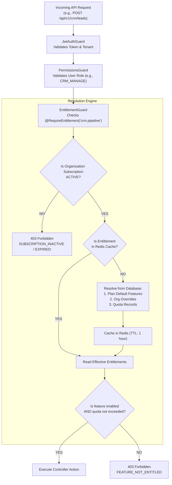

# GYMOS — ENTITLEMENT ENGINE ARCHITECTURE

**Document Version:** 1.0.0  
**Classification:** Core System Architecture Specification  
**Status:** PROPOSED & READY FOR APPROVAL  

---

## 1. Architectural Objective

The GymOS **Entitlement Engine** is the authoritative backend and frontend gating system that determines whether a specific gym organization (`organization_id`) has the legal, operational, and technical rights to execute an action, access an API endpoint, or view a user interface module.

### Core Principles
1. **Server-Side Authoritative (Fail-Closed):** Frontend hiding is for user experience only. The backend must strictly reject unauthorized requests with HTTP `403 Forbidden` and error code `FEATURE_NOT_ENTITLED`.
2. **Deterministic Resolution Hierarchy:** An organization's effective entitlements are calculated dynamically through a strict priority sequence.
3. **High-Performance Caching:** Active entitlements are cached in Redis per organization with instant invalidation upon Super Admin modification.
4. **Comprehensive Audit Trail:** Any override, addition, or revocation is permanently recorded in the immutable audit log.

---

## 2. Entitlement Resolution Sequence



### Hierarchy of Resolution
When evaluating a feature key (e.g. `training.workout_builder`) for tenant `X`:
1. **Subscription Status Gate:** If the organization's subscription status is `SUSPENDED`, `CANCELLED`, or `PAST_DUE` (past grace period), ALL non-core operations are blocked.
2. **Organization Override (Highest Priority):** If an explicit entry exists in `organization_entitlement_overrides` for `(organizationId, featureKey)`:
   - If `is_enabled = false` $\rightarrow$ **DENIED** (even if the gym's plan includes it).
   - If `is_enabled = true` $\rightarrow$ **GRANTED** (custom add-on granted by Super Admin).
   - If numeric quota is specified $\rightarrow$ override value replaces plan limit.
3. **Plan Default (Base Priority):** If no override exists, the feature setting is read from the organization's active SaaS plan (`saas_plan_features`).
4. **System Default (Fallback):** If unassigned in plan, default is `false` (fail-closed).

---

## 3. NestJS Backend Enforcement

### 3.1 Decorator: `@RequireEntitlement(featureKey)`
```typescript
// apps/api/src/common/auth/require-entitlement.decorator.ts
import { SetMetadata } from '@nestjs/common';

export const REQUIRE_ENTITLEMENT_KEY = 'require_entitlement';
export const RequireEntitlement = (featureKey: string) =>
  SetMetadata(REQUIRE_ENTITLEMENT_KEY, featureKey);
```

### 3.2 Guard: `EntitlementGuard`
Executes on every mutating and query endpoint after `JwtAuthGuard`:
```typescript
// apps/api/src/common/auth/entitlement.guard.ts
@Injectable()
export class EntitlementGuard implements CanActivate {
  constructor(
    private readonly reflector: Reflector,
    private readonly entitlementService: EntitlementService,
  ) {}

  async canActivate(context: ExecutionContext): Promise<boolean> {
    const featureKey = this.reflector.getAllAndOverride<string>(
      REQUIRE_ENTITLEMENT_KEY,
      [context.getHandler(), context.getClass()],
    );

    if (!featureKey) {
      return true; // No entitlement restriction on this route
    }

    const request = context.switchToHttp().getRequest();
    const user = request.user;
    const organizationId = user?.organizationId;

    if (!organizationId) {
      if (user?.isSuperAdmin) return true; // Super Admin bypass for platform admin APIs
      throw new ForbiddenException('Missing tenant context');
    }

    // Evaluate entitlement through centralized service
    const isEntitled = await this.entitlementService.isEntitled(
      organizationId,
      featureKey,
    );

    if (!isEntitled) {
      throw new ForbiddenException({
        statusCode: HttpStatus.FORBIDDEN,
        error: 'Forbidden',
        message: 'This feature is not included in your GymOS subscription plan. Please contact your platform administrator to upgrade.',
        code: 'FEATURE_NOT_ENTITLED',
        featureKey,
      });
    }

    return true;
  }
}
```

### 3.3 Numeric Quota Validation in Service Layer
When adding a new member, branch, or sending a WhatsApp message:
```typescript
// Example: Validating member creation limit
await this.entitlementService.assertWithinQuota(
  organizationId,
  'members.max_active',
  async () => {
    return tx.member.count({ where: { organizationId, status: 'ACTIVE' } });
  },
);
```

If the count exceeds the plan limit (e.g. 250 members on Starter), the engine raises:
```json
{
  "statusCode": 403,
  "error": "Forbidden",
  "message": "Maximum active member capacity (250) reached for your plan. Upgrade your plan to add more members.",
  "code": "QUOTA_EXCEEDED",
  "featureKey": "members.max_active",
  "currentUsage": 250,
  "maxLimit": 250
}
```

---

## 4. Frontend Client Integration & Dynamic Navigation

### 4.1 Entitlements Provider & Context
Upon login and organization selection, the client fetches the organization's effective entitlements:
`GET /api/v1/auth/me/entitlements`

```typescript
export interface OrganizationEntitlementsContext {
  planName: string;
  planCode: string;
  expiresAt: string;
  isExpired: boolean;
  features: Record<string, boolean>;
  quotas: Record<string, { current: number; max: number }>;
}
```

### 4.2 Dynamic Sidebar Menu Filtering
In `Sidebar.tsx`, nav items specify their required entitlement:
```typescript
{
  label: "Lead CRM",
  href: "/dashboard/crm",
  icon: Target,
  requiredFeature: "crm.pipeline",
}
```
If `features['crm.pipeline'] === false`, the sidebar either hides the tab or displays a subtle locked badge based on gym owner configuration.

### 4.3 Component Gating: `<EntitlementGate>`
For granular in-page features (e.g. "Export to CSV" or "WhatsApp Reminders"):
```tsx
<EntitlementGate
  feature="attendance.export_csv"
  fallback={
    <div className="p-4 rounded-xl border border-dashed border-border text-center">
      <Sparkles className="w-5 h-5 mx-auto text-primary-400 mb-1" />
      <p className="text-xs font-semibold text-foreground">Export to CSV is a Pro Feature</p>
      <p className="text-[11px] text-foreground-muted">Upgrade your GymOS plan to download raw attendance logs.</p>
    </div>
  }
>
  <button onClick={handleExportCsv} className="btn-secondary">
    Download CSV
  </button>
</EntitlementGate>
```

---

## 5. Super Admin Overrides & Instant Cache Invalidation

When a Super Admin grants an add-on or enables a module for a specific gym:
1. Super Admin issues `PATCH /api/v1/platform/organizations/:id/entitlements`.
2. Database record inserted/updated in `organization_entitlement_overrides`.
3. Audit log written to `entitlement_change_logs`.
4. Redis cache key deleted: `DEL gymos:entitlements:${organizationId}`.
5. On the gym owner's next API request, the cache is rebuilt instantly with the new privileges.

---

*Entitlement Engine Specification maintained by GymOS Core Architecture Board.*
