# GYMOS — ENTERPRISE FEATURE & SERVICE CATALOG

**Document Version:** 1.0.0  
**Classification:** Core System Architecture Specification  
**Status:** PROPOSED & READY FOR APPROVAL  

---

## 1. Overview & Naming Convention

The GymOS Entitlement Engine relies on a centralized, granular **Feature Catalog**. Every capability, module, and usage-gated action within GymOS is assigned a permanent, unique dot-notation key (`module.submodule.action`).

### Feature Key Syntax
`[domain].[capability].[scope_or_level]`

### Entitlement Types
- **BOOLEAN:** Feature is either fully enabled (`true`) or disabled (`false`) for the organization.
- **NUMERIC_QUOTA:** Feature has a maximum capacity or monthly quota limit (e.g., maximum members, branches, monthly WhatsApp messages).
- **TIERED:** Feature behavior adapts based on assigned level (e.g., `basic` vs `advanced` reports).

---

## 2. Complete Module & Feature Matrix

### Domain 1: Core System & Multi-Branch (`core.*`)

| Feature Key | Name | Type | Default Starter | Default Pro | Default Enterprise | Description |
| :--- | :--- | :---: | :---: | :---: | :---: | :--- |
| `core.branches.max` | Maximum Branches | NUMERIC | 1 | 3 | 25 | Maximum active branches the gym can operate. |
| `core.branches.manage` | Branch Management | BOOLEAN | true | true | true | Ability to configure branch profiles, facilities, and working hours. |
| `core.staff.max` | Maximum Staff Accounts | NUMERIC | 3 | 10 | 100 | Maximum staff logins (Admin, Receptionist, Trainer). |
| `core.staff.roles` | Custom Staff RBAC | BOOLEAN | false | true | true | Ability to customize staff roles and granular branch assignments. |
| `core.audit_logs.view` | Security Audit Logs | BOOLEAN | false | true | true | Access to system security audit trails and staff activity history. |

---

### Domain 2: Member Management (`members.*`)

| Feature Key | Name | Type | Default Starter | Default Pro | Default Enterprise | Description |
| :--- | :--- | :---: | :---: | :---: | :---: | :--- |
| `members.max_active` | Maximum Active Members | NUMERIC | 250 | 1,000 | 10,000 | Total active member capacity permitted in database. |
| `members.directory` | Member Directory | BOOLEAN | true | true | true | Member listing, profile search, photo upload, and status management. |
| `members.import_export` | Bulk Import / Export | BOOLEAN | false | true | true | CSV bulk import and Excel export of member rosters. |
| `members.documents` | Digital KYC & Waiver Uploads| BOOLEAN | false | true | true | Storage of member government ID proof, medical clearances, and signed waivers. |
| `members.notes_medical` | Health & Medical Profiling | BOOLEAN | false | true | true | Member injury history, medical notes, and trainer guidelines. |

---

### Domain 3: Membership Contracts & Plans (`memberships.*`)

| Feature Key | Name | Type | Default Starter | Default Pro | Default Enterprise | Description |
| :--- | :--- | :---: | :---: | :---: | :---: | :--- |
| `memberships.plans.manage` | Membership Plan Creator | BOOLEAN | true | true | true | Create plans (Monthly, Quarterly, Annual, Day Pass). |
| `memberships.renewals` | Membership Renewals | BOOLEAN | true | true | true | In-system renewal tracking and contract extension. |
| `memberships.freeze_thaw` | Contract Freeze & Thaw | BOOLEAN | false | true | true | Temporarily pause membership days (medical/vacation) with validity recalculation. |
| `memberships.transfer` | Membership Transfer | BOOLEAN | false | false | true | Transfer membership contract between family members or branches. |

---

### Domain 4: Attendance & Access Control (`attendance.*`)

| Feature Key | Name | Type | Default Starter | Default Pro | Default Enterprise | Description |
| :--- | :--- | :---: | :---: | :---: | :---: | :--- |
| `attendance.reception_scanner`| Reception Camera Scanner | BOOLEAN | true | true | true | Front desk camera scanning dynamic member QR passes. |
| `attendance.kiosk_qr` | Daily Counter Display QR | BOOLEAN | true | true | true | Reception tablet/monitor displaying daily rotating QR for self-check-in. |
| `attendance.manual_checkin`| Staff Manual Check-in | BOOLEAN | true | true | true | Manual staff entry by member name/phone/passcode. |
| `attendance.badge_passcodes`| Physical 6-Digit Passcodes | BOOLEAN | false | true | true | RFID card / numeric keypad check-in codes. |
| `attendance.auto_checkout` | Distributed Auto-Checkout | BOOLEAN | true | true | true | BullMQ background worker automatically closing stale open sessions. |
| `attendance.export_csv` | Attendance History CSV | BOOLEAN | true | true | true | UTF-8 BOM compliant attendance record logs export. |
| `attendance.turnstile_api` | Hardware Turnstile Webhook | BOOLEAN | false | false | true | Direct integration with biometric turnstiles and RFID barriers. |

---

### Domain 5: Billing, Invoicing & Payments (`billing.*`)

| Feature Key | Name | Type | Default Starter | Default Pro | Default Enterprise | Description |
| :--- | :--- | :---: | :---: | :---: | :---: | :--- |
| `billing.invoices` | Automated Tax Invoices | BOOLEAN | true | true | true | Generation of compliant tax invoices with GST/VAT calculations. |
| `billing.payments` | Payment Tracking & Receipts| BOOLEAN | true | true | true | Cash, Card, UPI, and Bank transfer payment recording with instant PDF receipt. |
| `billing.dues_tracking` | Aging Dues Tracking | BOOLEAN | true | true | true | 30/60/90 days overdue tracking and collection management. |
| `billing.credits` | Member Credit Wallets | BOOLEAN | false | true | true | Prepaid balance, advance payments, and internal credit management. |
| `billing.refunds` | Partial & Full Refunds | BOOLEAN | false | true | true | Staff refund processing with audit log and invoice status updating. |
| `billing.online_gateway` | Integrated Payment Gateway | BOOLEAN | false | true | true | Razorpay / Stripe payment links for members to pay dues online. |

---

### Domain 6: Workouts, Training & Trainers (`training.*`)

| Feature Key | Name | Type | Default Starter | Default Pro | Default Enterprise | Description |
| :--- | :--- | :---: | :---: | :---: | :---: | :--- |
| `training.trainers.manage` | Trainer Roster & Assignment| BOOLEAN | false | true | true | Assign personal trainers to members with session tracking. |
| `training.workout_builder` | Workout Plan Builder | BOOLEAN | false | true | true | Exercise database, sets/reps routines, and muscle group split creator. |
| `training.diet_builder` | Diet & Nutrition Creator | BOOLEAN | false | true | true | Calorie targets, macronutrient split, and meal-by-meal diet planner. |
| `training.client_logging` | Member Workout Logging | BOOLEAN | false | false | true | Members logging weights, PRs, and exercise completion in portal. |

---

### Domain 7: Class & Session Booking (`classes.*`)

| Feature Key | Name | Type | Default Starter | Default Pro | Default Enterprise | Description |
| :--- | :--- | :---: | :---: | :---: | :---: | :--- |
| `classes.schedule` | Group Class Scheduling | BOOLEAN | false | true | true | Yoga, Zumba, CrossFit, and spinning group class schedule builder. |
| `classes.capacity_booking` | Member Capacity Booking | BOOLEAN | false | true | true | Member seat reservation with waitlist and live capacity limits. |

---

### Domain 8: Lead CRM & Business Growth (`crm.*`)

| Feature Key | Name | Type | Default Starter | Default Pro | Default Enterprise | Description |
| :--- | :--- | :---: | :---: | :---: | :---: | :--- |
| `crm.leads.max` | Maximum Stored Leads | NUMERIC | 100 | 1,000 | 25,000 | Maximum prospective member leads tracked in pipeline. |
| `crm.pipeline` | Visual Sales Kanban Pipeline| BOOLEAN | false | true | true | Drag-and-drop lead stages (New, Contacted, Trial Booked, Won, Lost). |
| `crm.followups` | Follow-up Call Scheduling | BOOLEAN | false | true | true | Receptionist task queue for pending follow-ups and trial conversion. |
| `crm.lead_sources` | Attribution & Source ROI | BOOLEAN | false | true | true | Tracking leads by source (Walk-in, Instagram, Referral, Google Maps). |

---

### Domain 9: Marketing, WhatsApp & Communication (`communication.*`)

| Feature Key | Name | Type | Default Starter | Default Pro | Default Enterprise | Description |
| :--- | :--- | :---: | :---: | :---: | :---: | :--- |
| `communication.email.notifications` | Automated Transactional Email | BOOLEAN | true | true | true | Automated welcome emails, invoice receipts, and expiry warnings. |
| `communication.whatsapp.official` | WhatsApp Cloud API Integration| BOOLEAN | false | true | true | Official Meta WhatsApp Business API connectivity. |
| `communication.whatsapp.monthly_quota` | Monthly WhatsApp Messages | NUMERIC | 0 | 500 | 5,000 | Allowance of outbound WhatsApp messages included in billing cycle. |
| `communication.broadcasts` | Promotional Campaigns | BOOLEAN | false | false | true | Mass announcements to active members or leads. |

---

### Domain 10: Automation Workflow Builder (`automation.*`)

| Feature Key | Name | Type | Default Starter | Default Pro | Default Enterprise | Description |
| :--- | :--- | :---: | :---: | :---: | :---: | :--- |
| `automation.expiry_alerts` | Automated Expiry Reminders | BOOLEAN | true | true | true | Standard triggers 7, 3, and 1 day prior to membership expiry. |
| `automation.dues_reminders`| Automated Payment Reminders | BOOLEAN | true | true | true | Overdue invoice alerts to members via WhatsApp/Email. |
| `automation.birthday_wishes`| Birthday & Occasion Alerts | BOOLEAN | false | true | true | Automated personalized wishes with gym offer discounts. |
| `automation.custom_workflows`| Visual Event Workflow Builder| BOOLEAN | false | false | true | Custom trigger-condition-action workflow automation engine. |

---

### Domain 11: Reports & Business Analytics (`reports.*`)

| Feature Key | Name | Type | Default Starter | Default Pro | Default Enterprise | Description |
| :--- | :--- | :---: | :---: | :---: | :---: | :--- |
| `reports.basic_kpis` | Operational KPI Dashboard | BOOLEAN | true | true | true | Daily check-ins, active members, revenue today, expiring soon. |
| `reports.financial_advanced`| Revenue, Tax & Cashflow Reports| BOOLEAN | false | true | true | Monthly collection vs dues, GST tax ledgers, refunds breakdown. |
| `reports.retention_churn` | Cohort Churn & Retention Analytics| BOOLEAN | false | false | true | Member renewal rate, drop-off heatmap, and retention trends. |

---

### Domain 12: Artificial Intelligence (`ai.*`)

| Feature Key | Name | Type | Default Starter | Default Pro | Default Enterprise | Description |
| :--- | :--- | :---: | :---: | :---: | :---: | :--- |
| `ai.member_engagement` | AI Member Winback Predictor | BOOLEAN | false | false | true | AI detection of declining attendance predicting churn before expiry. |
| `ai.workout_generator` | AI Workout & Diet Generator | BOOLEAN | false | false | true | Generative AI creating personalized workout/diet splits from member goals. |
| `ai.business_insights` | Executive Revenue Copilot | BOOLEAN | false | false | true | AI natural language analytics on gym profitability and pricing optimization. |

---

## 3. Predefined SaaS Subscription Packages

The Super Admin can offer these standard packaged plans or create custom packages on the fly:

```mermaid
graph TD
    classDef starter fill:#1e293b,stroke:#3b82f6,stroke-width:2px;
    classDef pro fill:#1e1b4b,stroke:#8b5cf6,stroke-width:2px;
    classDef enterprise fill:#064e3b,stroke:#10b981,stroke-width:2px;

    Starter["STARTER PLAN<br/>Single Branch • 250 Members<br/>Core + QR Attendance + Basic Billing"]:::starter
    Pro["PRO GROWTH PLAN<br/>3 Branches • 1,000 Members<br/>Full Billing + Workouts + CRM + WhatsApp"]:::pro
    Enterprise["ENTERPRISE TITAN PLAN<br/>25 Branches • 10,000 Members<br/>Custom Automations + Turnstiles + AI Engine"]:::enterprise
```

1. **GymOS Starter (Affordable Essentials):**
   - Ideal for single-location gyms and boutique fitness studios.
   - Includes: Single branch, up to 250 members, QR attendance, invoice creation, basic operational KPIs.
2. **GymOS Pro (High Growth):**
   - Ideal for popular fitness clubs and growing multi-branch operations.
   - Includes: Up to 3 branches, 1,000 active members, lead CRM pipeline, workout & diet builders, WhatsApp integration (500 msgs/mo), advanced financial reports.
3. **GymOS Enterprise (Franchise & Luxury Chains):**
   - Ideal for multi-city gym franchises.
   - Includes: Unlimited branches/staff, custom workflow automations, hardware turnstile integration, dedicated WhatsApp quota (5,000 msgs/mo), churn AI predictors, and white-label member portal.

---

*Feature Catalog Specification maintained by GymOS Core Architecture Board.*
