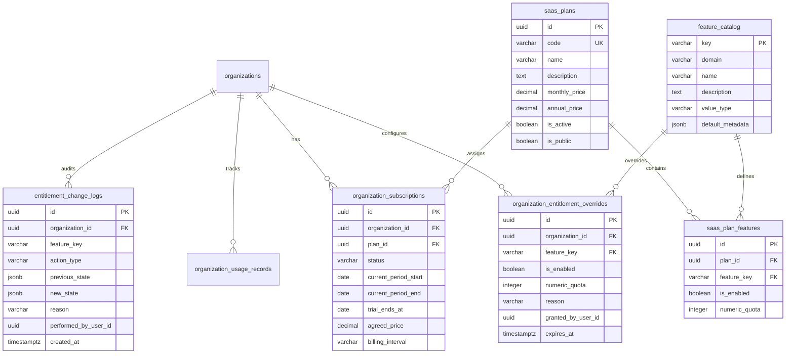
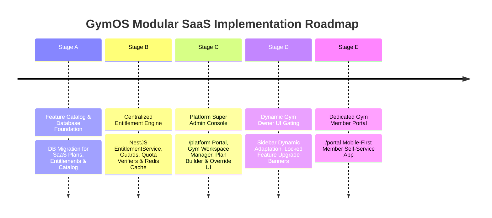

# GYMOS — MODULAR ENTERPRISE SAAS & SERVICE ENTITLEMENT ARCHITECTURE

**Specification Version:** 1.0.0  
**Classification:** Core System Architecture Specification  
**Status:** PROPOSED & READY FOR APPROVAL  
**Author:** Antigravity Autonomous Engineering Agent  

---

## 1. Executive Summary & Problem Analysis

### 1.1 The Problem in Current Architecture
In the current implementation of GymOS:
1. **Monolithic Feature Availability:** Every organization registered in the database inherits an identical, hardcoded set of routes and capabilities (Members, Attendance, Invoices, Plans). If a gym owner only purchased a basic Attendance package, they still see and have backend access to Billing and Multiple Branches.
2. **Missing Platform Administration:** The `SUPER_ADMIN` currently has no dedicated management portal. Super Admins are presented with a raw `/select-organization` tenant switcher containing test seed orgs, with zero ability to:
   - Create and price commercial SaaS subscription plans.
   - Toggle individual modules on/off per gym.
   - Set member, branch, or WhatsApp message quotas.
   - Manage gym subscription billing, invoices, and renewals.
3. **Ambiguity Between SaaS vs Gym Billing:** The database has `MembershipPlan` and `Invoice`, but these represent *gym members paying the gym*. There are no database tables representing *the gym paying the GymOS SaaS platform*.

### 1.2 The Solution: Modular Enterprise SaaS
GymOS will transition into a true **Multi-Tenant Modular SaaS Platform** where:
- The **Platform Owner (Super Admin)** packages, prices, sells, monitors, and dynamically toggles modules for unlimited gym businesses.
- The **Gym Owner (SaaS Customer)** operates inside an isolated workspace tailored strictly to their subscribed services.
- The **Gym Customer (Member)** accesses a dedicated, branded Member Portal.

---

## 2. Three Primary User Personas & Workspace Boundaries

```mermaid
graph TD
    classDef platform fill:#1e1b4b,stroke:#8b5cf6,stroke-width:2px;
    classDef tenant fill:#0f172a,stroke:#3b82f6,stroke-width:2px;
    classDef member fill:#064e3b,stroke:#10b981,stroke-width:2px;

    SA["PLATFORM OWNER<br/>(SUPER_ADMIN)<br/>Route: /platform/*<br/>Role: System Governor"]:::platform
    GO["GYM OWNER & STAFF<br/>(TENANT USERS)<br/>Route: /dashboard/*<br/>Roles: Owner, Admin, Receptionist, Trainer"]:::tenant
    GC["GYM MEMBER<br/>(END CONSUMER)<br/>Route: /portal/*<br/>Role: Member (Self-Service)"]:::member

    SA -->|Configures Plans, Entitlements & Limits| GO
    GO -->|Operates Gym, Manages Plans & Workouts| GC
    GC -->|Views Pass, Attendance, Invoices & Diets| GO
```



| Dimension | 1. Platform Super Admin | 2. Gym Owner & Staff | 3. Gym Member / Customer |
| :--- | :--- | :--- | :--- |
| **Primary Route Base** | `/platform/*` | `/dashboard/*` | `/portal/*` |
| **Scope of Authority** | Global (All Organizations, System-wide) | Tenant-Scoped (Single Gym Organization) | Personal-Scoped (Single Member Identity) |
| **Database RLS Context** | `SET LOCAL app.is_super_admin = 'true'` | `SET LOCAL app.current_tenant_id = $orgId` | `SET LOCAL app.current_tenant_id = $orgId` (Member filter) |
| **Primary Capabilities** | Plan creator, tenant manager, entitlement override, SaaS revenue analytics | Reception scanner, members roster, dues collection, staff manager | Digital QR pass, workout/diet viewer, payment receipts, attendance log |

---

## 3. Dedicated Platform Super Admin Console (`/platform/*`)

The Super Admin will access a dedicated, security-isolated administrative suite:

### 3.1 Views & Capabilities
1. **Platform Overview (`/platform`):**
   - Live MRR (Monthly Recurring Revenue), ARR, Active Gyms, Suspended Gyms, Total System Members.
   - Quick alerts: Gym subscriptions expiring within 7 days, overdue SaaS payments, quota utilization alerts.
2. **Gym Organizations Manager (`/platform/organizations`):**
   - Searchable, filterable list of all registered gyms (Name, Slug, Plan, Status, Joined Date, Quota usage).
   - Instant Actions: **Activate**, **Suspend**, **Reset Credentials**, **Impersonate (Read-Only Support)**.
3. **SaaS Plan Builder (`/platform/plans`):**
   - Create standard tiers: *Starter*, *Pro*, *Enterprise*.
   - Define monthly/annual pricing (INR / USD), billing cycles, grace periods.
   - Select default feature entitlements and numeric quotas (branches, members, staff, WhatsApp messages).
4. **Per-Gym Service Entitlement Manager (`/platform/organizations/[orgId]/entitlements`):**
   - Deep configuration panel for an individual gym:
     - Toggle any module on/off with a single click.
     - Override plan limits (e.g., standard Starter allows 1 branch, but grant Apex Fitness 2 branches as a custom deal).
     - Add-on services: WhatsApp integration, Hardware Turnstile API, AI Churn Engine.
     - Set custom billing rates and expiration dates.
5. **Platform Revenue & SaaS Billing (`/platform/billing`):**
   - Invoices issued to gym owners for their GymOS software subscriptions.
   - Payment tracking (Bank transfer, Stripe, Razorpay) and overdue enforcement.
6. **System Audit Logs (`/platform/audit-logs`):**
   - Immutable record of every plan assignment, module toggle, limit override, and suspension event.

---

## 4. Database Schema Design (New SaaS Entities)

The schema respects existing `Organization`, `Branch`, and `User` tables without breaking or duplicating current attendance or billing logic:



### 4.1 Strict Separation of SaaS vs Gym Billing
- **SaaS Billing:** `organization_subscriptions` and `saas_invoices` (Gym pays GymOS).
- **Gym Billing:** Existing `invoices`, `payments`, `membership_plans` (Gym Member pays Gym).
- This clean separation ensures zero schema pollution and zero risk to existing membership validation logic.

---

## 5. API Architecture & Endpoint Design

### 5.1 Platform Administration Endpoints (Super Admin Only)
Guarded by `@SuperAdminOnly()`:
- `GET    /api/v1/platform/overview` $\rightarrow$ System-wide stats, MRR, gym counts
- `GET    /api/v1/platform/organizations` $\rightarrow$ Paginated gym list with usage metrics
- `POST   /api/v1/platform/organizations` $\rightarrow$ Provision new gym workspace
- `PATCH  /api/v1/platform/organizations/:id/status` $\rightarrow$ Suspend/Activate gym
- `GET    /api/v1/platform/plans` $\rightarrow$ List SaaS plans
- `POST   /api/v1/platform/plans` $\rightarrow$ Create SaaS plan
- `PATCH  /api/v1/platform/plans/:id` $\rightarrow$ Update plan pricing and default features
- `GET    /api/v1/platform/organizations/:id/entitlements` $\rightarrow$ View gym effective entitlements & overrides
- `PATCH  /api/v1/platform/organizations/:id/entitlements` $\rightarrow$ Apply custom overrides (enable/disable module, set quota)
- `GET    /api/v1/platform/audit-logs` $\rightarrow$ View platform audit trail

### 5.2 Tenant-Scoped Endpoints (Gym Owner & Staff)
Guarded by `@RequireEntitlement(featureKey)`:
- `GET    /api/v1/auth/me/entitlements` $\rightarrow$ Returns effective features & quotas for current gym
- `POST   /api/v1/crm/leads` $\rightarrow$ Blocked if `crm.pipeline` is not entitled
- `POST   /api/v1/members` $\rightarrow$ Blocked if `members.max_active` quota is exceeded
- `POST   /api/v1/training/workout-plans` $\rightarrow$ Blocked if `training.workout_builder` is not entitled
- `POST   /api/v1/attendance/check-in/qr` $\rightarrow$ Blocked if `attendance.reception_scanner` is not entitled

### 5.3 Member Self-Service Endpoints (Gym Customer Portal)
Guarded by `@MemberOnly()`:
- `GET    /api/v1/portal/me` $\rightarrow$ Member profile, active pass & gym branding
- `GET    /api/v1/portal/attendance` $\rightarrow$ Member's personal check-in history
- `GET    /api/v1/portal/invoices` $\rightarrow$ Member's personal invoices & payment links
- `GET    /api/v1/portal/workouts` $\rightarrow$ Assigned workout routines (if gym has training module enabled)

---

## 6. Frontend Routing & User Experience Architecture

```
apps/web/src/app/
├── (auth)/                          # Shared Login, Password Reset
│   ├── login/
│   └── register/
├── platform/                        # SUPER_ADMIN CONSOLE (New)
│   ├── layout.tsx                   # Dedicated Platform Sidebar & Navigation
│   ├── page.tsx                     # Platform Overview Dashboard
│   ├── organizations/               # Gym Organizations List & Management
│   │   ├── page.tsx
│   │   └── [orgId]/
│   │       ├── page.tsx             # Gym Details & Usage
│   │       └── entitlements/        # Per-Gym Module Toggle & Quota Overrides
│   ├── plans/                       # SaaS Plan Builder & Pricing
│   │   ├── page.tsx
│   │   └── new/
│   └── billing/                     # SaaS Subscription Revenue & Invoices
├── dashboard/                       # GYM OWNER & STAFF PANEL (Existing & Protected)
│   ├── layout.tsx                   # Dynamic Sidebar (Entitlement-Aware)
│   ├── page.tsx                     # Overview Dashboard
│   ├── attendance/                  # Attendance & Kiosk (Gated by attendance.*)
│   ├── members/                     # Member Roster (Quota-Gated)
│   ├── billing/                     # Gym Invoices & Dues (Gated by billing.*)
│   ├── crm/                         # Leads Pipeline (Gated by crm.*)
│   └── training/                    # Workout & Diet Builder (Gated by training.*)
└── portal/                          # GYM CUSTOMER / MEMBER PORTAL (New)
    ├── layout.tsx                   # Mobile-First Member App Shell (Gym Branded)
    ├── page.tsx                     # Member Digital Card & Quick QR
    ├── attendance/                  # Personal Visits Calendar
    ├── payments/                    # Invoices & Receipts
    └── workouts/                    # Assigned Workout Routines
```

---

## 7. Security, Invariants & RLS Defense-in-Depth

1. **PostgreSQL RLS Inviolability:**
   - Platform Super Admin routes run within `withSuperAdminContext` explicitly setting `SET LOCAL app.is_super_admin = 'true';`.
   - Tenant routes run within `withTenantContext` strictly binding to `SET LOCAL app.current_tenant_id = $tenantId;`.
   - Even if a Super Admin accidentally executes a query without proper tenant context on tenant tables, RLS policies prevent data corruption.
2. **Double-Gated Authorization (RBAC + Entitlement):**
   - An API request must satisfy **both** checks:
     - `PermissionsGuard`: Does Vikram Malhotra have `MEMBERSHIP_CREATE` role?
     - `EntitlementGuard`: Does Apex Fitness have `memberships.plans.manage` entitled in their SaaS plan?
   - If either fails, request is rejected with explicit reason.
3. **Immutability of Audit Trails:**
   - All entitlement changes record: `organization_id`, `feature_key`, `previous_state`, `new_state`, `reason`, `performed_by_user_id`, and `timestamp`.
   - No `DELETE` or `UPDATE` operations are permitted on `entitlement_change_logs`.

---

## 8. Phased Implementation Roadmap



- **Phase A (Foundation):** Schema migration for `saas_plans`, `feature_catalog`, `organization_subscriptions`, and `organization_entitlement_overrides`. Pre-seed all existing gyms with full `ENTERPRISE` default entitlements so existing operations suffer zero disruption.
- **Phase B (Entitlement Engine):** Implement `@RequireEntitlement` decorator, `EntitlementGuard`, and `EntitlementService` with Redis caching.
- **Phase C (Super Admin Experience):** Implement `/platform` dashboard, organization service manager, and module toggles.
- **Phase D (Tenant Dynamic Shell):** Update `Sidebar.tsx` and admin routes to dynamically adapt to gym's active entitlements.
- **Phase E (Member Portal):** Create `/portal` mobile-responsive self-service experience for gym members.

---

*Modular SaaS Architecture Specification approved by GymOS Core Architecture Board.*
