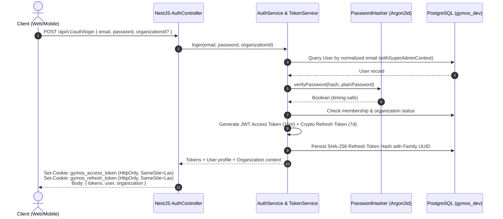
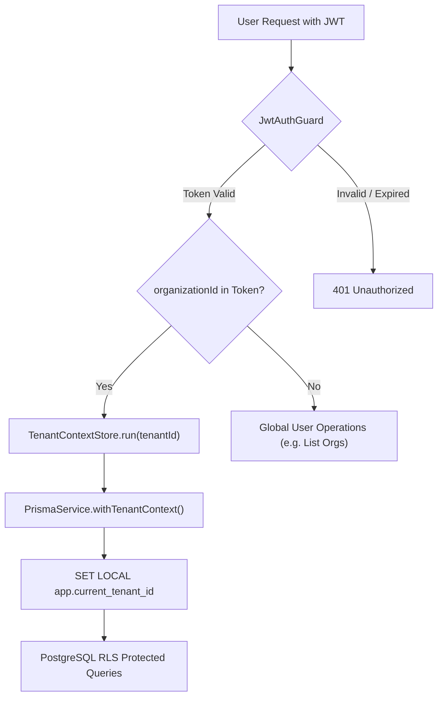

# GymOS Authentication Architecture

## 1. Executive Summary

GymOS employs a production-grade, multi-tenant authentication and authorization architecture designed for zero-trust tenant boundaries, resilient session management, and granular Role-Based Access Control (RBAC).

Global user identity is decoupled from gym-specific tenancy: a single user identity can belong to multiple gym organizations with distinct roles in each organization, while platform administrative operations are strictly isolated via `isSuperAdmin`.

---

## 2. Authentication Flow



---

## 3. Session & Token Architecture

GymOS uses a hybrid session model combining short-lived signed JWTs and cryptographically secure database-tracked refresh tokens:

| Token Type | Lifespan | Storage / Transport | Cryptographic Mechanism |
|---|---|---|---|
| **Access Token** | 15 minutes | HttpOnly Cookie + `Authorization: Bearer` header | Signed HS256 JWT containing `sub`, `email`, `organizationId`, `role`, `permissions` |
| **Refresh Token** | 7 days | HttpOnly Cookie (`gymos_refresh_token`) + JSON body | 40-byte cryptographically secure random hex string (`crypto.randomBytes(40)`) |
| **Refresh Storage** | 7 days | PostgreSQL `refresh_tokens` table | SHA-256 hash (`crypto.createHash('sha256')`), never plaintext |
| **Password Reset** | 1 hour | PostgreSQL `password_reset_tokens` table | 32-byte secure random hex, stored as SHA-256 hash, single-use |
| **Email Verification** | 24 hours | PostgreSQL `email_verification_tokens` table | 32-byte secure random hex, stored as SHA-256 hash, single-use |

### 3.1 Token Rotation & Reuse Detection

Each refresh token issuance belongs to a cryptographically unique `family` UUID. When a client presents a valid refresh token:
1. The token hash is checked in PostgreSQL.
2. If the token is already revoked, a **Security Alert** is raised, and **ALL active sessions in that family are immediately revoked** (mitigating stolen token replay).
3. If valid, the current token is marked `isRevoked: true` with pointer `replacedByTokenHash`, and a new refresh token is issued within the same `family`.
4. A new 15-minute access token is minted.

---

## 4. Multi-Tenant Context Resolution & Switching

When an authenticated user requests an action:
1. `JwtAuthGuard` validates the JWT token and decodes `{ sub, organizationId, role, permissions }`.
2. The user identity and tenant context are placed into `AsyncLocalStorage` (`TenantContextStore`).
3. Database transactions for tenant-owned entities automatically execute inside `PrismaService.withTenantContext(organizationId, ...)`, setting PostgreSQL session variable:
   ```sql
   SET LOCAL app.current_tenant_id = '<organization_uuid>';
   ```
4. If a user belongs to multiple gyms, they switch active contexts via `POST /api/v1/auth/organizations/:id/select`:
   - Server-side lookup verifies user membership in `organization_users`.
   - Server-side check verifies organization `status = 'ACTIVE'`.
   - New access token is minted with the target `organizationId` and assigned `role`.



---

## 5. Cookie Security Specifications

All cookies issued by GymOS adhere to the following security posture:

```typescript
// Access Token Cookie
res.cookie('gymos_access_token', token, {
  httpOnly: true,
  secure: process.env.NODE_ENV === 'production',
  sameSite: 'lax',
  path: '/',
  maxAge: 15 * 60 * 1000, // 15 minutes
});

// Refresh Token Cookie
res.cookie('gymos_refresh_token', refreshToken, {
  httpOnly: true,
  secure: process.env.NODE_ENV === 'production',
  sameSite: 'lax',
  path: '/',
  maxAge: 7 * 24 * 60 * 60 * 1000, // 7 days
});
```

---

## 6. Endpoints Catalog

| Method | Route | Access | Description |
|---|---|---|---|
| `POST` | `/api/v1/auth/register` | Public | Register global user + optional gym, assigns `GYM_OWNER` |
| `POST` | `/api/v1/auth/login` | Public | Authenticate credentials with Argon2id, issue cookies & tokens |
| `POST` | `/api/v1/auth/refresh` | Public | Rotate refresh token with reuse detection |
| `POST` | `/api/v1/auth/logout` | Public/Auth | Revoke active refresh token and clear cookies |
| `POST` | `/api/v1/auth/forgot-password` | Public | Request password reset (anti-enumeration generic response) |
| `POST` | `/api/v1/auth/reset-password` | Public | Reset password using single-use token, revokes all active sessions |
| `POST` | `/api/v1/auth/verify-email` | Public | Consume email verification token |
| `GET` | `/api/v1/auth/me` | Authenticated | Retrieve authenticated user profile and active gym context |
| `GET` | `/api/v1/auth/organizations` | Authenticated | List all gym organizations user is authorized for |
| `POST` | `/api/v1/auth/organizations/:id/select` | Authenticated | Select active gym workspace and rotate access token |
| `GET` | `/api/v1/auth/sessions` | Authenticated | List all active login sessions for user |
| `DELETE` | `/api/v1/auth/sessions/:id` | Authenticated | Revoke a specific active session |
