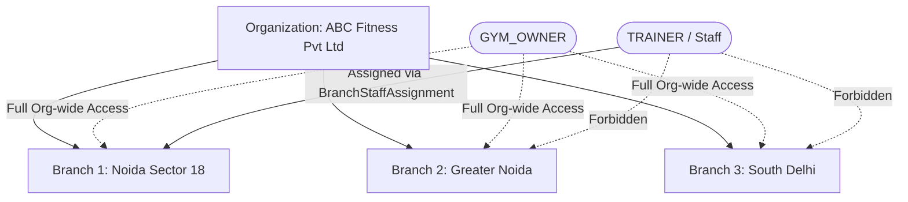
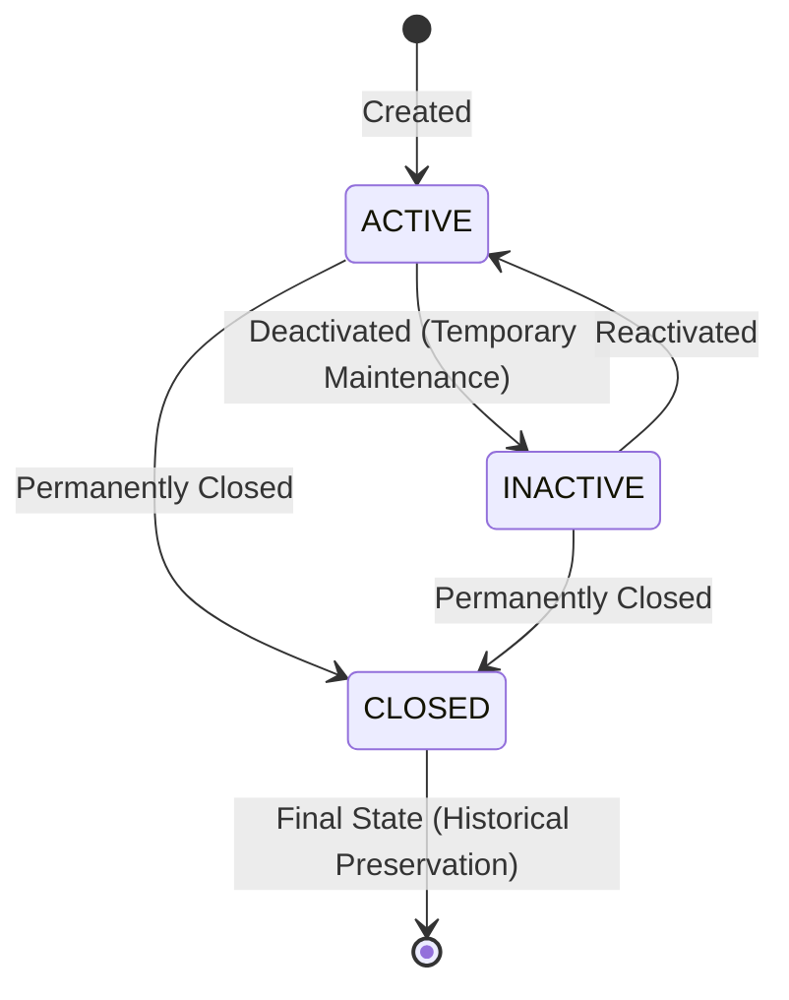

# Multi-Branch Management Architecture

## 1. Architectural Distinction: Tenant vs. Branch

A fundamental rule of the GymOS architecture:

> **Organization = Tenant** (Primary RLS security boundary)  
> **Branch = Physical Facility Location** (Child of an Organization)

Branches are **NOT** independent tenants. Every branch belongs to exactly one organization via `organization_id`. Database tenant isolation remains enforced by `app.current_tenant_id = organization_id`. Branch-scoped operations are an additional application-level authorization layer on top of PostgreSQL RLS.



## 2. Branch Data Model

The `branches` table records physical gym facilities:

| Column | Type | Constraints | Description |
|---|---|---|---|
| `id` | UUID (PK) | DEFAULT `gen_random_uuid()` | Primary identifier of the branch |
| `organization_id` | UUID (FK) | `REFERENCES organizations(id)` ON DELETE CASCADE | Parent tenant organization |
| `name` | VARCHAR(255) | NOT NULL | Display name of the branch location |
| `slug` | VARCHAR(100) | NOT NULL | URL identifier within the tenant |
| `branch_code` | VARCHAR(50) | NOT NULL | Alphanumeric location code (e.g. `ALPHA-SEC18`) |
| `description` | TEXT | NULLABLE | Facility overview and features |
| `email` | VARCHAR(255) | NULLABLE | Branch specific contact email |
| `phone` | VARCHAR(50) | NULLABLE | Branch specific contact phone |
| `website` | VARCHAR(255) | NULLABLE | Branch specific microsite or URL |
| `logo_url` | VARCHAR(500) | NULLABLE | Branch logo or storefront image |
| `address_line_1` | VARCHAR(255) | NULLABLE | Facility street address |
| `address_line_2` | VARCHAR(255) | NULLABLE | Floor, unit, plaza |
| `city` | VARCHAR(100) | NULLABLE | City / Municipality |
| `state` | VARCHAR(100) | NULLABLE | State / Province |
| `country` | VARCHAR(100) | NULLABLE | Country |
| `postal_code` | VARCHAR(20) | NULLABLE | Postal PIN code |
| `timezone` | VARCHAR(50) | NOT NULL DEFAULT `'UTC'` | Local timezone for future scheduling |
| `status` | `branch_status` | DEFAULT `'ACTIVE'` | `ACTIVE`, `INACTIVE`, `CLOSED` |
| `created_at` | TIMESTAMPTZ | DEFAULT `CURRENT_TIMESTAMP` | Record timestamp |
| `updated_at` | TIMESTAMPTZ | DEFAULT `CURRENT_TIMESTAMP` | Last updated timestamp |

### Uniqueness & Constraints
- `UNIQUE (organization_id, slug)`: Prevents duplicate slugs within a gym enterprise.
- `UNIQUE (organization_id, branch_code)`: Prevents duplicate branch codes within a gym enterprise (identical codes across different gym enterprises are permitted).
- `UNIQUE (organization_id, id)`: Enables composite foreign key references from child tables.

## 3. Branch Lifecycle & Status Transitions



1. **ACTIVE**: Full operational access. Accessible for branch selection and staff assignments.
2. **INACTIVE**: Temporarily closed (renovation, maintenance). Excluded from active scheduling and cannot receive new staff assignments.
3. **CLOSED**: Permanently ceased operations. Irreversible terminal state; branches are **never hard-deleted** to protect audit integrity and historical records.

## 4. Branch Staff Assignment System

The `branch_staff_assignments` association table models staff deployment:

| Column | Type | Constraints |
|---|---|---|
| `id` | UUID (PK) | DEFAULT `gen_random_uuid()` |
| `organization_id` | UUID (FK) | `REFERENCES organizations(id)` |
| `branch_id` | UUID (FK) | `REFERENCES branches(id)` |
| `organization_user_id` | UUID (FK) | `REFERENCES organization_users(id)` |
| `status` | `assignment_status` | `ACTIVE`, `INACTIVE` |
| `assigned_at` | TIMESTAMPTZ | Assignment timestamp |
| `assigned_by` | UUID | User ID of assigning administrator |

### Composite Integrity Protection
To eliminate cross-tenant data corruption at the database engine level, two composite foreign keys are enforced by PostgreSQL:
```sql
ALTER TABLE "branch_staff_assignments" ADD CONSTRAINT "fk_branch_staff_branch_org"
  FOREIGN KEY ("organization_id", "branch_id") REFERENCES "branches"("organization_id", "id") ON DELETE CASCADE;

ALTER TABLE "branch_staff_assignments" ADD CONSTRAINT "fk_branch_staff_user_org"
  FOREIGN KEY ("organization_id", "organization_user_id") REFERENCES "organization_users"("organization_id", "id") ON DELETE CASCADE;
```
This guarantees that an assignment can **never** link a branch in Org A with a user membership in Org B.
