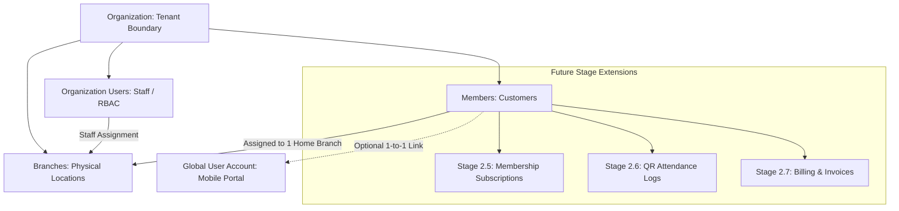
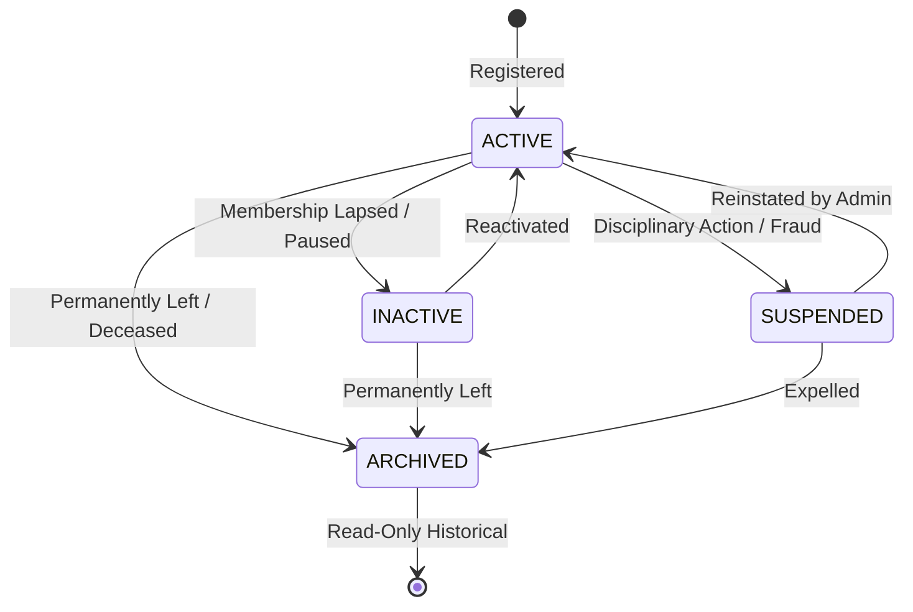

# GymOS — Member Management Architectural Design (Stage 2.4 Planning)

## 1. System Topology & Architectural Boundary

---

## 2. Key Architecture Decisions (ADRs)

### ADR-2.4.1: Decoupling Gym Members from Staff / RBAC Identities
- **Decision**: Members are stored in a dedicated `members` table, completely distinct from `organization_users`.
- **Rationale**:
  - 95%+ of gym members do not need administrative dashboard access.
  - Gym members should not require email/password or create clutter in the authentication table.
  - Allows gyms to enroll walk-in members who only have a phone number.
  - Supports optional linkage to a global `User` account (`user_id UUID NULL`) for future member self-service mobile app access without mixing RBAC roles.

### ADR-2.4.2: Atomic Counter Table for Member Numbers
- **Decision**: Use `organization_member_sequences` table with PostgreSQL `ON CONFLICT DO UPDATE ... RETURNING` row-locking semantics.
- **Rationale**:
  - Avoids duplicate key collisions during parallel registrations at different branches.
  - Guarantees zero sequence gaps without relying on complex distributed locking in Redis.
  - Member numbers remain immutable upon branch transfer.

### ADR-2.4.3: Soft Archival over Hard Deletion
- **Decision**: Member records are never hard deleted from PostgreSQL (`status: ARCHIVED`, `archived_at TIMESTAMPTZ`).
- **Rationale**:
  - Preserves financial, attendance, and audit integrity for past transactions and legal retention.

---

## 3. Member Lifecycle State Machine

### Lifecycle Rules:
1. **ACTIVE**: Full facility access, active for future attendance checking.
2. **INACTIVE**: Temporarily inactive (no current subscription, voluntary hold).
3. **SUSPENDED**: Blocked by management. Cannot check in or renew without manager intervention.
4. **ARCHIVED**: Terminal state. Excluded from active directory searches by default.
