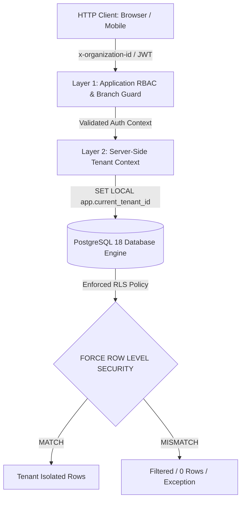

# GymOS — Member Security & Isolation Design Specification (Stage 2.4 Planning)

## 1. Dual-Layer Defense Architecture

GymOS enforces a strict two-layer isolation model for Member data:



---

## 2. PostgreSQL Row-Level Security (RLS) Specifications

### 2.1 RLS Enablement & Enforcement
```sql
-- Enable and force RLS on members table
ALTER TABLE "members" ENABLE ROW LEVEL SECURITY;
ALTER TABLE "members" FORCE ROW LEVEL SECURITY;

-- Enable and force RLS on member_transfers table
ALTER TABLE "member_transfers" ENABLE ROW LEVEL SECURITY;
ALTER TABLE "member_transfers" FORCE ROW LEVEL SECURITY;

-- Enable and force RLS on organization_member_sequences table
ALTER TABLE "organization_member_sequences" ENABLE ROW LEVEL SECURITY;
ALTER TABLE "organization_member_sequences" FORCE ROW LEVEL SECURITY;
```

### 2.2 RLS Isolation Policies
```sql
-- Members Tenant Isolation Policy
CREATE POLICY "tenant_isolation_policy_members" ON "members"
  AS RESTRICTIVE
  FOR ALL
  USING (
    current_setting('app.is_super_admin', true) = 'true'
    OR
    organization_id = NULLIF(current_setting('app.current_tenant_id', true), '')::uuid
  )
  WITH CHECK (
    current_setting('app.is_super_admin', true) = 'true'
    OR
    organization_id = NULLIF(current_setting('app.current_tenant_id', true), '')::uuid
  );

-- Member Transfers Policy
CREATE POLICY "tenant_isolation_policy_member_transfers" ON "member_transfers"
  AS RESTRICTIVE
  FOR ALL
  USING (
    current_setting('app.is_super_admin', true) = 'true'
    OR
    organization_id = NULLIF(current_setting('app.current_tenant_id', true), '')::uuid
  )
  WITH CHECK (
    current_setting('app.is_super_admin', true) = 'true'
    OR
    organization_id = NULLIF(current_setting('app.current_tenant_id', true), '')::uuid
  );

-- Member Sequence Policy
CREATE POLICY "tenant_isolation_policy_member_sequences" ON "organization_member_sequences"
  AS RESTRICTIVE
  FOR ALL
  USING (
    current_setting('app.is_super_admin', true) = 'true'
    OR
    organization_id = NULLIF(current_setting('app.current_tenant_id', true), '')::uuid
  )
  WITH CHECK (
    current_setting('app.is_super_admin', true) = 'true'
    OR
    organization_id = NULLIF(current_setting('app.current_tenant_id', true), '')::uuid
  );
```

### 2.3 Non-Superuser Database Role Privileges
```sql
GRANT SELECT, INSERT, UPDATE, DELETE ON "members" TO gymos_user;
GRANT SELECT, INSERT, UPDATE, DELETE ON "member_transfers" TO gymos_user;
GRANT SELECT, INSERT, UPDATE, DELETE ON "organization_member_sequences" TO gymos_user;
```

---

## 3. RBAC Permissions Matrix for Member Management

| Permission String | Description | `SUPER_ADMIN` | `GYM_OWNER` | `GYM_ADMIN` | `RECEPTIONIST` | `TRAINER` | `MEMBER` |
|---|---|:---:|:---:|:---:|:---:|:---:|:---:|
| `member.read` | View member directory and profiles | ✅ | ✅ | ✅ | ✅ (Assigned) | ✅ (Assigned) | ❌ |
| `member.create` | Register new gym members | ✅ | ✅ | ✅ | ✅ (Assigned) | ❌ | ❌ |
| `member.update` | Edit member profile details | ✅ | ✅ | ✅ | ✅ (Assigned) | ❌ | ❌ |
| `member.status.manage` | Suspend or activate a member | ✅ | ✅ | ✅ | ✅ (Assigned) | ❌ | ❌ |
| `member.transfer` | Transfer member to another branch | ✅ | ✅ | ✅ | ❌ | ❌ | ❌ |
| `member.archive` | Archive a deceased or left member | ✅ | ✅ | ✅ | ❌ | ❌ | ❌ |

---

## 4. Branch Context & Authorization Enforcement

Every member operation is bound to a physical branch:
1. **Creation**:
   - `branchId` must be specified in the request body (or defaulted to validated `x-branch-id`).
   - `BranchContextService.validateBranchAccess()` ensures:
     - The target branch belongs strictly to the authenticated tenant.
     - The target branch is `ACTIVE` (cannot register members at an inactive/closed branch).
     - Staff (Receptionist) is assigned to that specific branch.
2. **Reading / Directory**:
   - Owners and Admins can view members across all branches or filter by branch.
   - Receptionists and Trainers are automatically restricted to members belonging to their assigned branches.
3. **Branch Transfer**:
   - Both `fromBranchId` and `toBranchId` are validated:
     - Both must belong to the same tenant.
     - Destination branch must be `ACTIVE`.
     - Caller must possess `member.transfer` permission.

---

## 5. Audit Logging Specifications

All member mutations generate an immutable record in `audit_logs`:

| Action | Entity | Metadata Captured |
|---|---|---|
| `MEMBER_CREATED` | `Member` | `{ memberNumber, branchId, firstName, lastName, phone }` |
| `MEMBER_UPDATED` | `Member` | `{ changes: { ...diff } }` |
| `MEMBER_STATUS_CHANGED` | `Member` | `{ previousStatus, newStatus, reason }` |
| `MEMBER_TRANSFERRED` | `Member` | `{ fromBranchId, toBranchId, reason }` |
| `MEMBER_ARCHIVED` | `Member` | `{ archivedAt, reason }` |

All audit logs automatically capture `organizationId`, `userId`, `ipAddress`, and `userAgent`.
