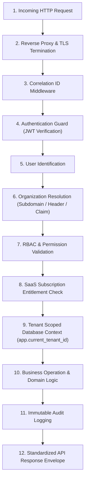

# GymOS Multi-Tenancy Architecture & Security Specification

> [!IMPORTANT]
> **Stage 1 Status & Honest Boundary**:
> This document specifies the comprehensive multi-tenant design for GymOS. In Stage 1, the foundational schema models (`Organization`, `User`, `OrganizationUser`, `AuditLog`) are created. Full PostgreSQL Row-Level Security (RLS) policies, session variable injection, and automated cross-tenant penetration tests will be implemented and validated during Stage 2. No claims of full multi-tenant enforcement are made until those tests are in place.

---

## 1. Tenancy Model: Shared Database, Tenant-Aware Tables with RLS

GymOS utilizes a **Shared Database, Shared Schema with Tenant-Aware Tables and PostgreSQL Row-Level Security (RLS)** architecture.

### Why Shared Database with RLS?

1. **Cost Efficiency**: Managing separate databases for 1,000+ small-to-medium gyms incurs significant idle compute, connection pool, and maintenance overhead.
2. **Operational Simplicity**: Database migrations, backups, and schema evolution are executed once across the entire platform.
3. **Database-Enforced Security**: With PostgreSQL Row-Level Security, data isolation is guaranteed by the database engine kernel itself, preventing accidental cross-tenant leaks even if an application developer forgets a `WHERE organization_id = ...` clause.

---

## 2. The Complete Request Lifecycle

Every authenticated HTTP request to GymOS executes through the following strict lifecycle:



### Detailed Lifecycle Steps:

1. **Incoming Request**: Client initiates HTTP request with `Authorization: Bearer <token>` and optional `x-organization-id` header.
2. **Reverse Proxy & TLS**: Enforces HTTPS, rate limits, and DDoS mitigation.
3. **Correlation ID Middleware**: Injects or passes `x-correlation-id` into request context and response headers.
4. **Authentication**: JWT signature and expiration verified.
5. **User Identification**: Extracts `userId` and user status.
6. **Organization Resolution**: Resolves target gym organization via:
   - Request subdomain (e.g. `titan-fitness.gymos.cloud`)
   - Header: `x-organization-id`
   - Active user organization claim inside the JWT token
7. **Permission Validation**: Verifies that user holds valid role (`ORG_OWNER`, `ORG_STAFF`, `TRAINER`, `MEMBER`) within the specified organization.
8. **Subscription Entitlement**: Verifies the tenant's GymOS subscription is active and feature flags permit the action.
9. **Tenant Database Context**: Database connection executes `SET LOCAL app.current_tenant_id = '<uuid>'` inside the transaction.
10. **Business Operation**: Query executes with PostgreSQL RLS filtering rows automatically.
11. **Audit Logging**: Asynchronous audit entry recorded with `organization_id`, `user_id`, IP, user agent, and payload.
12. **Response**: Standardized JSON envelope returned to client.

---

## 3. PostgreSQL Row-Level Security (RLS) Design

In Stage 2, every tenant-owned table (e.g., `members`, `attendances`, `invoices`, `plans`) will enforce RLS:

```sql
-- Example Stage 2 RLS Policy Specification
ALTER TABLE members ENABLE ROW LEVEL SECURITY;
ALTER TABLE members FORCE ROW LEVEL SECURITY;

CREATE POLICY tenant_isolation_policy ON members
  FOR ALL
  USING (organization_id = NULLIF(current_setting('app.current_tenant_id', true), '')::uuid)
  WITH CHECK (organization_id = NULLIF(current_setting('app.current_tenant_id', true), '')::uuid);
```

### Transaction Scoping

The application sets the context per transaction:

```typescript
await prisma.$transaction(async (tx) => {
  await tx.$executeRawUnsafe(
    `SET LOCAL app.current_tenant_id = '${tenantId}';`,
  );
  // All queries executed within tx are strictly isolated to tenantId
  return tx.member.findMany();
});
```

---

## 4. Cross-Cutting Multi-Tenant Concerns

### 4.1 Tenant-Aware Background Jobs

BullMQ jobs must never process data across tenants without context. Every job payload includes:

```typescript
interface TenantJobPayload<T> {
  organizationId: string;
  correlationId: string;
  initiatedByUserId?: string;
  data: T;
}
```

Worker consumers unpack the payload, establish the tenant context, and scope all database and external API actions to that tenant.

### 4.2 Tenant-Aware Caching

All cache keys in Redis are strictly namespaced with the organization ID:

```
gymos:{tenantId}:{resource}:{id}
Example: gymos:8a62f8a1-4321-4f9e-990a-5c21bb098123:members:m_123
```

This guarantees zero key collisions and facilitates instantaneous cache invalidation upon tenant subscription changes.

### 4.3 Tenant-Aware File Storage

Object storage (S3 / Local storage) prefixes all asset paths with the organization ID:

```
/tenants/{organizationId}/assets/{category}/{filename}
Example: /tenants/8a62f8a1.../assets/member-photos/avatar-99.png
```

Pre-signed upload URLs and access tokens are restricted strictly to the tenant prefix.
