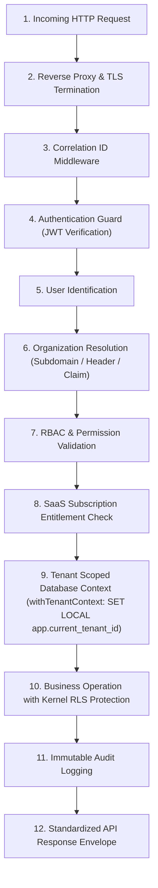

# GymOS Multi-Tenancy Architecture & Security Specification

> [!NOTE]
> **Phase 2.1 Multi-Tenant Security Foundation Status: IMPLEMENTED & VERIFIED**
> - PostgreSQL kernel Row-Level Security (RLS) policies are active and enforced on all tenant-owned tables (`organizations`, `organization_users`, `audit_logs`).
> - Both `ENABLE ROW LEVEL SECURITY` and `FORCE ROW LEVEL SECURITY` are applied, ensuring the application database role (`gymos_user`) cannot bypass RLS even as table owner.
> - Trusted server-side tenant context execution is implemented via `PrismaService.withTenantContext()` using PostgreSQL transaction-scoped `SET LOCAL app.current_tenant_id`.
> - Automated cross-tenant penetration test suite ([apps/api/test/tenant-isolation.e2e-spec.ts](file:///S:/GYM/apps/api/test/tenant-isolation.e2e-spec.ts)) verifies 13/13 security test cases on the live PostgreSQL 18 database.

---

## 1. Tenancy Model: Shared Database with Row-Level Security (RLS)

GymOS utilizes a **Shared Database, Shared Schema with Tenant-Aware Tables and PostgreSQL Row-Level Security (RLS)** architecture.

### Why Shared Database with RLS?
1. **Cost Efficiency**: Managing separate databases for 1,000+ gyms incurs excessive idle compute and connection pool overhead.
2. **Operational Simplicity**: Database migrations and schema evolution are executed once across the platform.
3. **Database-Enforced Security**: With PostgreSQL Row-Level Security, data isolation is guaranteed by the database engine kernel itself, preventing accidental cross-tenant leaks even if an application query lacks an explicit `WHERE organization_id = ...` clause.

---

## 2. Active PostgreSQL Row-Level Security Implementation

### 2.1 Applied RLS Policies (Migration: `20261118033000_enable_rls_policies`)

Every tenant-owned table enforces strict RLS and forced RLS:

```sql
-- 1. Organizations table
ALTER TABLE "organizations" ENABLE ROW LEVEL SECURITY;
ALTER TABLE "organizations" FORCE ROW LEVEL SECURITY;

CREATE POLICY "tenant_isolation_policy_organizations" ON "organizations"
  FOR ALL
  USING (
    NULLIF(current_setting('app.is_super_admin', true), '') = 'true'
    OR
    id = NULLIF(current_setting('app.current_tenant_id', true), '')::uuid
  )
  WITH CHECK (
    NULLIF(current_setting('app.is_super_admin', true), '') = 'true'
    OR
    id = NULLIF(current_setting('app.current_tenant_id', true), '')::uuid
  );

-- 2. Organization Users table
ALTER TABLE "organization_users" ENABLE ROW LEVEL SECURITY;
ALTER TABLE "organization_users" FORCE ROW LEVEL SECURITY;

CREATE POLICY "tenant_isolation_policy_organization_users" ON "organization_users"
  FOR ALL
  USING (
    NULLIF(current_setting('app.is_super_admin', true), '') = 'true'
    OR
    organization_id = NULLIF(current_setting('app.current_tenant_id', true), '')::uuid
  )
  WITH CHECK (
    NULLIF(current_setting('app.is_super_admin', true), '') = 'true'
    OR
    organization_id = NULLIF(current_setting('app.current_tenant_id', true), '')::uuid
  );

-- 3. Audit Logs table
ALTER TABLE "audit_logs" ENABLE ROW LEVEL SECURITY;
ALTER TABLE "audit_logs" FORCE ROW LEVEL SECURITY;

CREATE POLICY "tenant_isolation_policy_audit_logs" ON "audit_logs"
  FOR ALL
  USING (
    NULLIF(current_setting('app.is_super_admin', true), '') = 'true'
    OR
    organization_id = NULLIF(current_setting('app.current_tenant_id', true), '')::uuid
  )
  WITH CHECK (
    NULLIF(current_setting('app.is_super_admin', true), '') = 'true'
    OR
    organization_id = NULLIF(current_setting('app.current_tenant_id', true), '')::uuid
  );
```

### 2.2 Table Owner Bypass Prevention (`FORCE ROW LEVEL SECURITY`)
In standard PostgreSQL, the owner of a table bypasses RLS by default. By explicitly executing `ALTER TABLE ... FORCE ROW LEVEL SECURITY;`, the table owner (`gymos_user`) is strictly bound to RLS policies.
Furthermore, the application user `gymos_user` does NOT possess the PostgreSQL `BYPASSRLS` or `SUPERUSER` privileges:
```sql
SELECT rolname, rolsuper, rolbypassrls FROM pg_roles WHERE rolname = 'gymos_user';
-- Result: gymos_user | rolsuper: false | rolbypassrls: false
```

---

## 3. Trusted Server-Side Tenant Context Lifecycle (`SET LOCAL`)

All database queries execute through transaction-scoped context setting in `PrismaService`:

```typescript
// apps/api/src/database/prisma.service.ts
async withTenantContext<T>(
  tenantId: string,
  callback: (tx: Prisma.TransactionClient) => Promise<T>,
  isSuperAdmin = false,
): Promise<T> {
  if (!UUID_REGEX.test(tenantId)) {
    throw new Error(`Invalid tenant ID format: ${tenantId}`);
  }

  return this.$transaction(async (tx) => {
    await tx.$executeRawUnsafe(`SET LOCAL app.current_tenant_id = '${tenantId}';`);
    if (isSuperAdmin) {
      await tx.$executeRawUnsafe(`SET LOCAL app.is_super_admin = 'true';`);
    }
    return callback(tx);
  });
}
```

### Why `SET LOCAL`?
1. **Connection Pooling Safety**: `SET LOCAL` is scoped strictly to the current database transaction. When the transaction commits or rolls back, PostgreSQL automatically resets `app.current_tenant_id` to NULL. The connection returned to the connection pool is guaranteed clean.
2. **Default Deny**: If a query is executed outside of `withTenantContext`, `app.current_tenant_id` is unset (NULL). Under RLS policy rules, NULL matches nothing, resulting in 0 rows returned (strict default deny).

---

## 4. Cross-Tenant Penetration Test Results

Automated e2e test suite located at `apps/api/test/tenant-isolation.e2e-spec.ts`:

```
PASS apps/api/test/tenant-isolation.e2e-spec.ts
  Multi-Tenant Row-Level Security & Isolation (e2e)
    PostgreSQL Kernel Security Attributes Verification
      √ should verify connected role is gymos_user without BYPASSRLS or SUPERUSER privileges (5 ms)
      √ should verify RLS is ENABLED and FORCED on tenant-owned tables (4 ms)
    Default Deny Isolation (No Tenant Context Set)
      √ should return 0 organizations when no tenant context is established (6 ms)
      √ should return 0 organization_users when no tenant context is established (2 ms)
      √ should return 0 audit_logs when no tenant context is established (2 ms)
    Tenant Scoped Access (Tenant Alpha Context)
      √ should only see Tenant Alpha and never Tenant Beta (3 ms)
      √ should only see Tenant Alpha users and audit logs (6 ms)
    Cross-Tenant Penetration Attacks (Tenant Alpha Attempting to Access Tenant Beta)
      √ Penetration Attack 1 [SELECT]: Tenant Alpha attempting to read Tenant Beta by ID returns null (10 ms)
      √ Penetration Attack 2 [SELECT FILTER]: Tenant Alpha searching explicitly for Tenant Beta records returns empty array (6 ms)
      √ Penetration Attack 3 [INSERT TAMPERING]: Tenant Alpha attempting to insert row into Tenant Beta fails with RLS policy error (19 ms)
      √ Penetration Attack 4 [UPDATE TAMPERING]: Tenant Alpha attempting to update Tenant Beta organization fails or affects 0 rows (7 ms)
      √ Penetration Attack 5 [DELETE TAMPERING]: Tenant Alpha attempting to delete Tenant Beta records affects 0 rows (8 ms)
    Super Admin Cross-Tenant Scoping
      √ should allow Super Admin to query across all tenants simultaneously (7 ms)

Test Suites: 1 passed, 1 total
Tests:       13 passed, 13 total
```

---

## 5. The Complete Request Lifecycle


