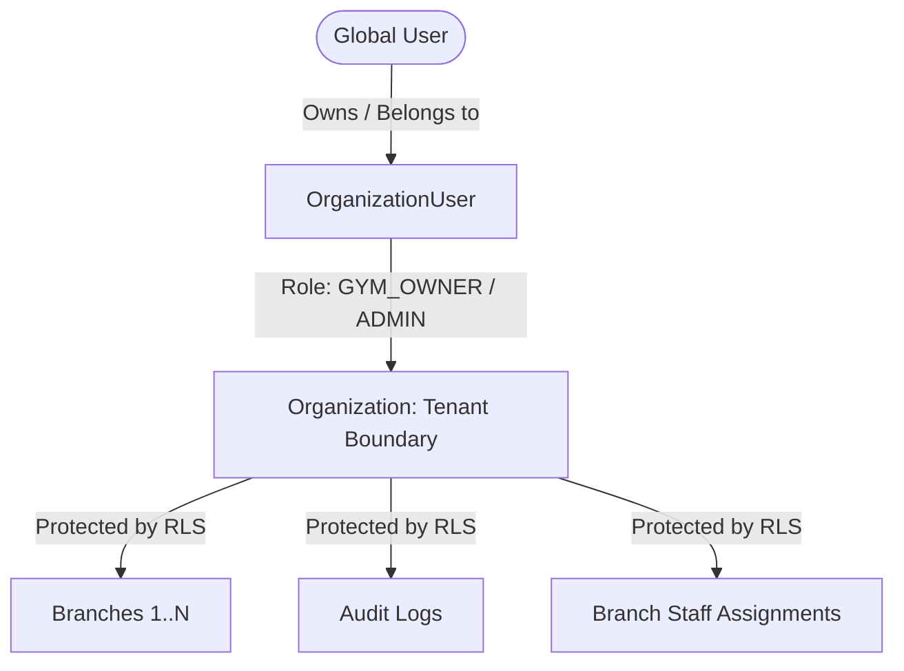

# Organization Management Architecture

## 1. Overview & Tenant Identity

In GymOS, an **Organization** represents an independent Gym Enterprise Tenant. It serves as the primary, immutable Row-Level Security (RLS) boundary across the entire platform. Every gym customer (from a single boutique gym to an enterprise gym network with dozens of branches) is isolated at the database level by their `organization_id`.

## 2. Organization Data Model

The `organizations` table stores enterprise profile attributes, contact channels, and localized regional settings:

| Column | Type | Description |
|---|---|---|
| `id` | UUID (PK) | Immutable primary tenant identifier. Referenced by `app.current_tenant_id` |
| `name` | VARCHAR(255) | Public display name of the gym enterprise |
| `slug` | VARCHAR(100) (Unique) | URL-safe identifier for tenant routing |
| `legal_name` | VARCHAR(255) | Registered corporate legal entity name |
| `business_email` | VARCHAR(255) | Enterprise primary contact email |
| `business_phone` | VARCHAR(50) | Official contact phone number |
| `website` | VARCHAR(255) | Corporate web portal |
| `logo_url` | VARCHAR(500) | Storage link to brand asset |
| `description` | TEXT | Enterprise description / biography |
| `address_line_1` | VARCHAR(255) | Registered office address |
| `address_line_2` | VARCHAR(255) | Suite, floor, or landmark |
| `city` | VARCHAR(100) | Municipality / City |
| `state` | VARCHAR(100) | State / Province |
| `country` | VARCHAR(100) | Sovereign country |
| `postal_code` | VARCHAR(20) | Postal PIN code |
| `timezone` | VARCHAR(50) | Enterprise default timezone (e.g. `Asia/Kolkata`, `UTC`) |
| `currency` | VARCHAR(10) | Enterprise default currency (e.g. `INR`, `USD`) |
| `status` | `tenant_status` | Operational state: `ACTIVE`, `SUSPENDED`, `TRIAL`, `CANCELLED` |
| `created_at` | TIMESTAMPTZ | Creation timestamp |
| `updated_at` | TIMESTAMPTZ | Automatic last-modified timestamp |

## 3. Tenant Boundary Integrity Rules

1. **Strict Context Isolation**: All organization profile and settings APIs resolve the tenant solely from the verified JWT claims (`request.user.organizationId`). The client never supplies an arbitrary organization ID in URLs or payloads for tenant mutation.
2. **PostgreSQL RLS Enforcement**: The `organizations` table is secured with `ENABLE ROW LEVEL SECURITY` and `FORCE ROW LEVEL SECURITY`. Queries outside `app.current_tenant_id` return zero rows.
3. **Reserved Slugs**: Slugs matching reserved routes (`admin`, `api`, `dashboard`, `auth`, `health`, etc.) are blocked by business validation.
4. **Audit Logging**: Any profile or settings changes are recorded in the immutable `audit_logs` table with previous and new metadata.
