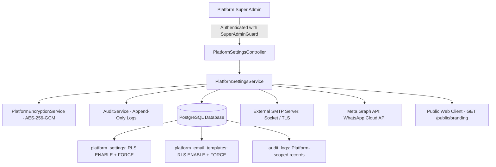

# GymOS Platform Settings Center — Architecture Specification

## 1. System Overview
The **Platform Settings Center** is an authoritative, platform-level configuration module residing strictly within the GymOS Super Admin Console (`/platform`). It controls the global behavior, appearance, communication integrations, and security auditing of the GymOS software platform itself.

> [!IMPORTANT]
> **Strict Platform vs. Tenant Boundary:**  
> This module controls the **GymOS PLATFORM itself**, completely isolated from individual gym organizations. Gym-specific branding, branch operating hours, and gym-specific membership plans remain governed by tenant RLS boundaries.

---

## 2. Core Modules

### 2.1 Website & Platform Branding (`/platform/settings/website`)
- **Storage:** Persisted in `platform_settings` table under key `WEBSITE_BRANDING`.
- **Fields:** Platform name, tagline, company legal entity, website URL, company address, support email, phone, light/dark logos, favicon, primary/secondary/accent hex color tokens, social channels, and footer copyright text.
- **Consumption:** Safely exposed via public unauthenticated endpoint `GET /api/v1/platform/public/branding` for consumption by landing pages and client apps.

### 2.2 SMTP Email Delivery (`/platform/settings/email`)
- **Storage:** Persisted in `platform_settings` table under key `SMTP_CONFIG`.
- **Security:** Plaintext SMTP password is sealed at rest using AES-256-GCM authenticated envelope encryption (`enc:v1:<iv>:<tag>:<ciphertext>`).
- **Features:** 
  - Connection tester executing real TCP/TLS socket handshake (`STARTTLS`, `SSL_TLS`, `NONE`).
  - Verification test email dispatcher.
  - Automatic masking (`••••••••`) on retrieval.
  - Partial updates preserve existing credentials without requiring re-entry.

### 2.3 Meta WhatsApp Cloud API (`/platform/settings/whatsapp`)
- **Storage:** Persisted in `platform_settings` table under key `WHATSAPP_CONFIG`.
- **Security:** Permanent System User access token sealed at rest using AES-256-GCM authenticated envelope encryption.
- **Features:**
  - Official Meta Graph API integration (`https://graph.facebook.com/${apiVersion}/${phoneNumberId}`).
  - Live connection verification querying phone number registration status.
  - Test messaging to authorized phone numbers with country code normalization.
  - Meta Webhook verification handshake (`hub.challenge`) and event receiver.

### 2.4 Email Template Studio (`/platform/settings/email-templates`)
- **Initial Seed:** 10 core transactional email templates auto-seeded on first run:
  1. `WELCOME_EMAIL`
  2. `EMAIL_VERIFICATION_OTP`
  3. `PASSWORD_RESET`
  4. `GYM_REGISTRATION_CONFIRMATION`
  5. `SAAS_SUBSCRIPTION_ACTIVATED`
  6. `SUBSCRIPTION_EXPIRY_REMINDER`
  7. `PAYMENT_SUCCESS`
  8. `PAYMENT_FAILED`
  9. `GYM_ACCOUNT_SUSPENDED`
  10. `SUBSCRIPTION_RENEWAL_REMINDER`
- **Variable Registry:** Controlled `{{variable_name}}` placeholders.
- **HTML Sanitization:** Active regex stripping of `<script>`, `onerror=`, `onload=`, and `javascript:` URIs.
- **Versioning:** Every save automatically increments `version` and archives the previous state in an immutable `history` array.
- **Preview & Test:** Live sample-data preview and test email dispatcher.

### 2.5 Platform Audit Logging (`/platform/settings/audit-logs`)
- **Storage:** Platform-scoped records in `audit_logs` where `organization_id IS NULL` and `entity IN ('PlatformSetting', 'PlatformEmailTemplate', 'PLATFORM')`.
- **Append-Only:** Mutations strictly append audit records capturing actor ID, timestamp, IP address, user agent, action code, and sanitized diffs.
- **Zero Secret Leakage:** Passwords, tokens, and raw credentials are scrubbed by `AuditService` prior to storage.
